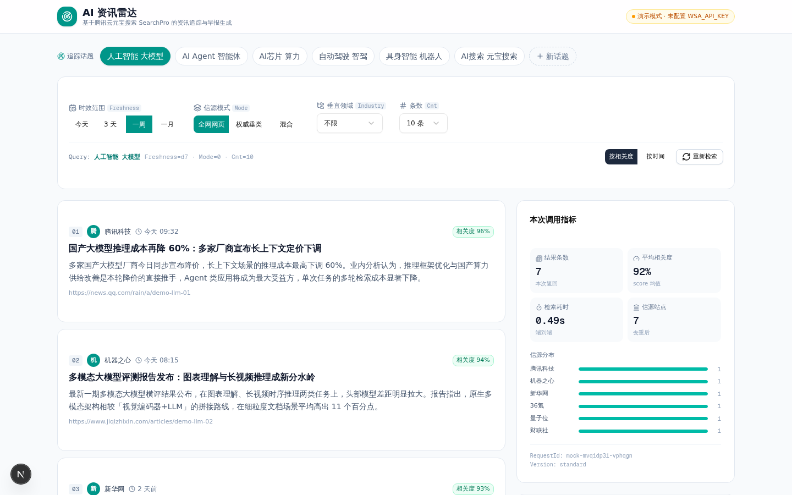
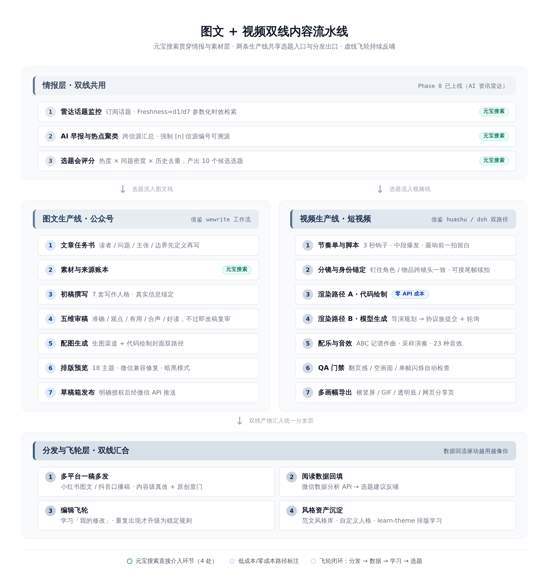
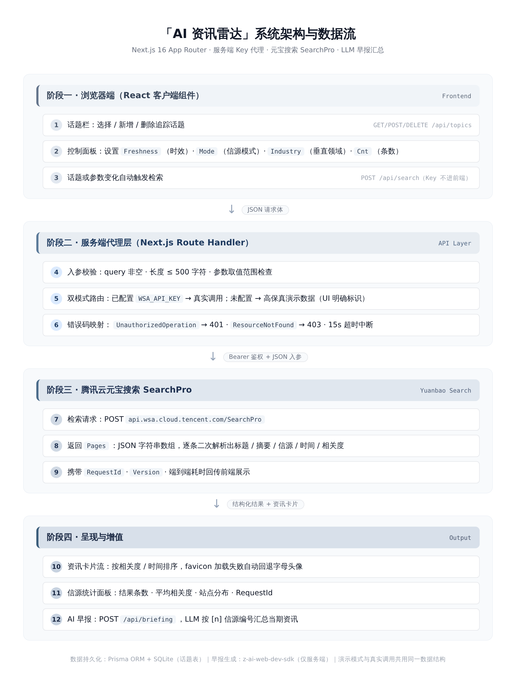

<div align="center">

# 📡 RadarForge

**AI News Radar · Content Creator's Production Line**

[](README.md) | [](README.en.md)

*Radar for intelligence, forge for content — from a raw signal to a published story.*


</div>

---

## What is this

RadarForge is a **content-creator workflow platform** that runs in your browser. It uses AI-powered web search as a radar to keep scanning for trending signals in your niche, then forges those signals into finished work — an illustrated article with an AI-generated cover, or a narrated short video.

One pipeline covers **topic → research → writing → artwork → video**, with no clipboard shuttling and no juggling eight windows along the way.



## Core capabilities

### 📡 Intelligence radar (search + RSS dual backend)
- **AI search** (Yuanbao SearchPro): real web results with real citations, not model hallucinations
- **RSS feeds**: 24 curated AI sources (qbitai / InfoQ / Hacker News / OpenAI / DeepMind / arXiv …, probe-verified), refreshed with bounded concurrency, dual-granularity freshness filtering and **SimHash cross-source dedup**; any item promotes into the idea pool in one click — see first, then produce
- **Topic tracking**: subscribe to the beats you care about; fresh signals land in your inbox
- **Source tracing**: every claim carries its original source link; per-feed fetch status is honestly recorded (failures never block the rest)

### ✍️ Article pipeline (9 steps · P0 quality pipeline)
brief → claims fact-gathering (keyword-overlap matching) → **outline-first** (JSON: per-section thesis / evidence ids / illustration slots) → **sectioned drafting** → **cross-family review** (different LLM family · pairwise adjudication · ≤2 rounds) → **atomic-assertion verification** (FActScore-style per-claim search; unsupported-rate gate blocks publishing) → inline illustrations → cover → WeChat layout (18 themes)

### 🖱️ Interaction (P1)
**3-step wizard** (topic → persona cards → confirm with preview; power users switch to advanced mode) | **⌘K command palette** (cross-line actions + recent-run jump) | **point-and-rewrite for articles** (hover any section → rewrite just that section → article version tree) | **run feedforward** (core judgment & outline preview while drafting) | **draft-first detail page** (evidence chain folded into a "why it's written this way" drawer)

### 🎬 Video pipeline (3 channels + direct-from-topic + hybrid)
Two sources: **adapt from a finished article** (recommended) or **direct from topic** (skip the article pipeline entirely); director's three directions → storyboard → motion commercial / art animation / Agnes AI model / **hybrid channel** (data & typography scenes via code animation, live-footage & mood scenes via AI inserts — cost ≈ 1/3 of pure-model) + BGM + per-scene revision tree

### 🖼️ Image line (generation + layout cards)
Topic → LLM composition plan → batch image generation (3 uses × 5 styles × 1–9 images); **layout cards** (Editorial/Swiss families × cover/quote/data templates — zero image-gen cost, pure code typesetting) + **VLM QA loop** (generated output read back by a vision model, retry with hint on failure) → gallery export

### 📏 Fixed eval set + publish gate + tuning loop (P0 metrics → P1 tuning)
50 fixed topics scored with a G-Eval-style 5-dim rubric (judge prefers a different LLM family); publish gate: review average ≥ 7.0 AND unsupported-assertion rate ≤ 30%; **prompt-variant tuning** (MIPROv2-lite): variants × eval subset → scoring → comparison → recommended variant persisted — regressable and reversible. Measure first, then cut.

### 🔌 Multi-model gateway
One unified adapter layer for four provider families — LLM / search / image / video — with **health probing**, key pools, and exponential backoff on failures. Switching providers never touches your code.

### 🧩 Plugin ecosystem
MCP server management plus a local plugin workspace (`skill-pool/`, kept out of git — see `.gitignore`) keeps capabilities pluggable.



## Architecture at a glance



| Layer | Stack |
|---|---|
| Frontend | Next.js 16 App Router + Tailwind 4 |
| Backend | Next.js API Routes + z-ai-web-dev-sdk |
| Data | Prisma + SQLite (14 tables) |
| Gateway | Provider adapters for 4 model families (429 backoff / WAF retry) |
| Media | ffmpeg compositing + AI image generation |

## Quick start

```bash
# 1. Install dependencies
bun install

# 2. Set up the database (SQLite, tables created automatically)
echo 'DATABASE_URL=file:./db/custom.db' > .env
bun run db:push

# 3. Run
bun run dev        # http://localhost:3000
```

> 💡 All model keys are configured inside the app's **Settings hub** (persisted to `SettingKV`). The `.env` file only needs `DATABASE_URL` — keys never enter git.

## Quality gates

- `tsc` and `eslint src/` both at zero
- 40+ item end-to-end main regression (`scripts/full-regression.mjs`): 9-step pipeline / eval set / video direct-from-topic / image line / 5-platform export / publish gate
- P1 suites: layout cards 33/33, point-and-rewrite 28/28 offline + 34/34 browser + 18/18 live, RSS feeds 37/37 incl. local-HTTP E2E, tuning loop 27/27
- Eval runner (`scripts/eval-set.mjs`) and tuning runner (`scripts/tune-prompts.mjs`): same-topic before/after comparison, scores are regressable
- Every change logged in `worklog.md`: what was built, what broke, how it was fixed

## Repository tour

```
src/
├── app/            # pages & API routes
├── components/     # UI components (incl. the settings hub)
├── lib/
│   ├── gateway/    # multi-model provider adapters
│   ├── settings.ts # settings read/write (with DEFAULTS fallback)
│   └── ...         # radar / article / video pipelines
prisma/schema.prisma # data model, 14 tables
scripts/            # regression / build / maintenance scripts
worklog.md          # full development log (Chinese)
download/           # screenshots & delivered assets
```

## Related work

- 📄 Contest write-up "AI News Radar 2.0" (Chinese): a four-tab walkthrough with 15 real screenshots (`download/比赛文章/`, not committed)
- 🛠️ Every "haunted bug" has a post-mortem: WAF retry, 429 backoff, a bare `.gitignore` rule that silently swallowed an API route, and a full-history secret scrub — all documented in `worklog.md`

## License

MIT
