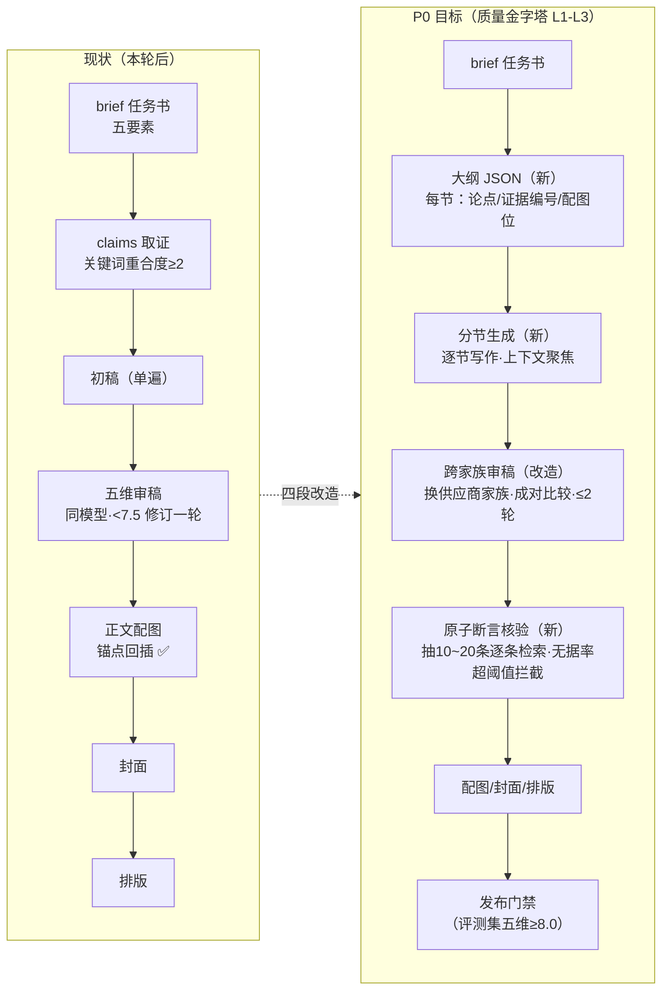
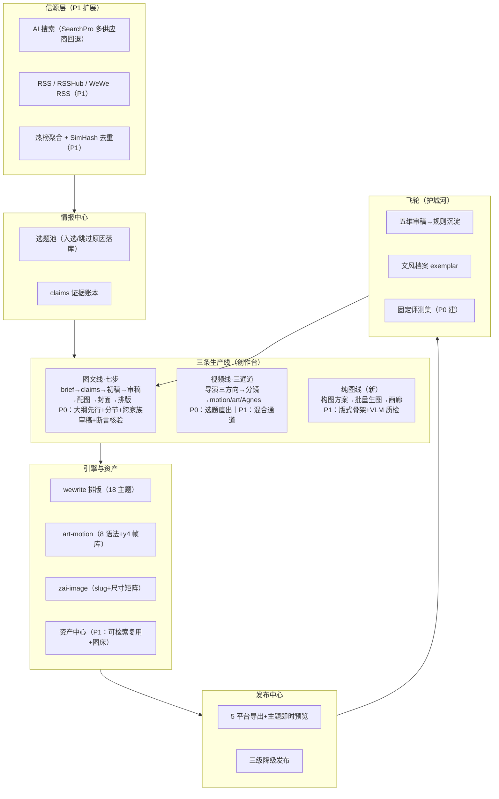
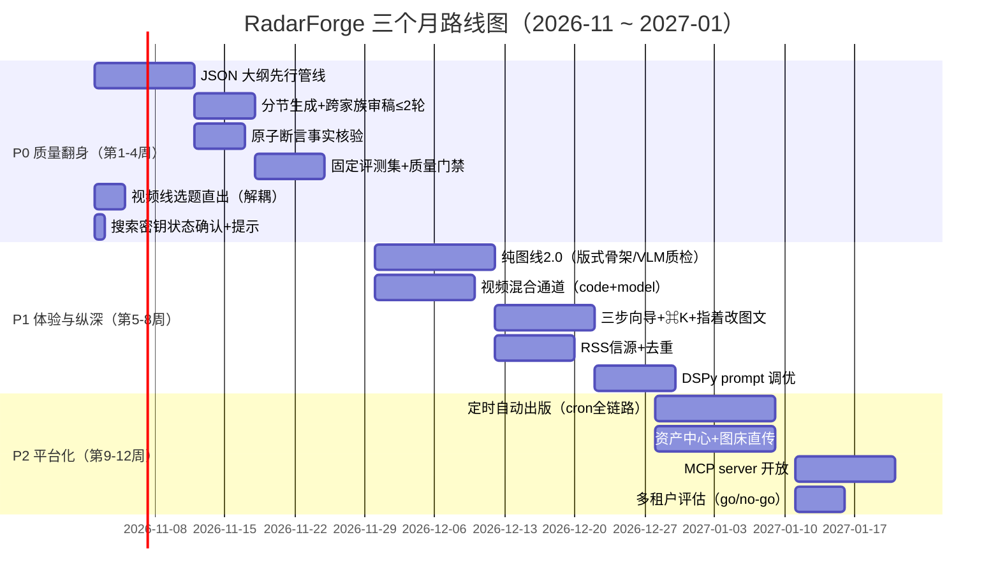

# RadarForge 产品深化方案 —— 从「能跑」到「顶尖」

> 版本：v1.0 ｜ 日期：2026-10-30 ｜ 作者：产品/架构/设计/工程联合视角
> 范围：回答本轮六问（纯图线 / 图文质量根因 / 视频线解耦与双轨 / 交互优化 / 顶尖质量方法论 / 拓展空间），给出 3 个月可落地路线图。
> 性质：决策 + 执行双文档。第 3 章每问含「已落地」与「待落地（P1/P2）」两个层次，落地项均以代码与回归证据为准。
>
> **P0 执行状态（2026-10-30 第二轮）**：P0 五项——大纲先行、分节生成、跨家族审稿（成对比较）、原子断言核验、固定评测集（50 题 + G-Eval 量表 + 发布门禁）、视频线选题直出——已全部落地入库（见文末附录 D 改动清单）。P1/P2 维持原计划。

---

## 1. 执行摘要

六问六答速览：

| # | 问题 | 一句话结论 | 状态 |
|---|------|-----------|------|
| 1 | 创作台加纯图线 | 已落地：两步流水线（LLM 构图方案 → zai-image 批量生图），3 用途 × 5 风格 × 1~9 张，画廊式产出 | ✅ 本轮交付 |
| 2 | 文章为什么没图、质量不高 | 三个根因：①管线只生成封面且从不插入正文（渲染器也不支持图片块）②claims「假命中」让引用不可信 ③初稿单遍生成无大纲无分节。①②已修，③是 P0 质量管线 | ①②已修 ✅ ③P0 已落地 ✅ |
| 3 | 视频线是否依赖图文线 | 当前产品动线上依赖（从有文章的 run 选稿），技术上可解耦；三通道已支持 AI 视频模型（Agnes），代码动画两风格（motion/art 8 语法）。建议：解耦 + 混合通道（代码动画为主、模型补 b-roll） | 解耦 P0 已落地 ✅（选题直出上线；混合通道仍 P1） |
| 4 | 交互优化 | 五个抓手：三步向导、运行前馈、详情页信息重排、⌘K 命令面板、指着改扩展到图文 | P1 |
| 5 | 质量如何到顶尖 | 五层质量金字塔（事实/结构/表达/视觉/度量），核心是「大纲先行 + 分节生成 + 跨家族审稿 + 原子断言核验 + 固定评测集」，全部有论文与开源工程背书 | P0 主战场 已落地 ✅（评测集试跑数据见附录 D） |
| 6 | 拓展空间 | 信源（RSS/RSSHub）、定时自动出版、资产中心、MCP 开放、多租户 SaaS；先纵深后平台 | P1/P2 |

战略小结（详见第 7 章）：RadarForge 的差异化不是「又一个 AI 写作工具」，而是**一人报社的内容军工厂**——一次选题，三条产线（图文/视频/图组），事实账本可溯源，飞轮越用越准。北极星指标建议定为**「周免修改直接可发布内容数」**。

---

## 2. 现状盘点与诚实诊断

### 2.1 产品现状（截至本轮提交）

```
情报中心（搜索 REAL + 选题池 + 去创作动线）
   └─ 创作台
        ├─ 图文线：brief → claims 取证 → 初稿 → 五维审稿 → 正文配图 → 封面 → 微信排版（18 主题）
        ├─ 视频线：导演三方向 → 分镜 → 三通道渲染（motion 商业片 / art 艺术动画 8 语法 / Agnes AI 模型）→ 指着改版本树
        └─ 纯图线（新）：构图方案 → 批量生图 → 画廊
   └─ 发布中心：5 平台导出（公众号/MD/知乎/小红书/头条）+ 主题即时预览 + 三级降级发布
   └─ 飞轮：五维审稿 → 规则沉淀（LearningRule）→ 注入后续初稿；文风档案（StyleExemplar）
```

质量基线：tsc / eslint 双零错误；全量回归主段 40+ 项断言全绿（含七步流水线端到端、纯图线端到端、5 平台导出、主题预览隔离）；视频段双风格成片回归通过；y4 故事帧引擎 11 帧全部通过 VLM 终检（房间/举手/反应/插入四类镜头无渲染破损）。

### 2.2 本轮代码诊断的三个根因（Q2 的答案）

**根因一：文章里没有图，是管线设计使然，不是模型失误。**
证据（改动前代码）：`run-manager.ts` 六步流水线中唯一生图调用是 Step 5 封面（`generateCoverImage`，1344×768 一张），产物存入 `Asset(role="cover")`，**从未插入正文 markdown**；同时三个渲染器（`render.ts` 微信排版、`platforms.ts` 多平台导出、块级解析器）都没有图片块类型，即使手工插图，`` 也会被当成普通文字段落。叠加一个工程缺陷：`zai-image.ts` 文件名写死 `cover-{runId}.png`，同一 run 想生成第二张图必然互相覆盖。
**已修（本轮）**：新增第五步 `illustrate 正文配图`——LLM 从成稿规划 2~3 个插图位（锚定小节标题、要求「图提供文字之外的信息量」），先验锚点再生成（不浪费生图调用），生成后回插 markdown，`Asset(role="inline")` 留痕；`generateImage` 重构支持 slug 防覆盖 + 三档尺寸白名单；三个渲染器全部支持 `<figure><figcaption>`；导出时对含图内容给出平台提示（公众号需上传素材库替换）。回归实测：**3/3 张插图插入正文并在微信 HTML 渲染为 figure**。

**根因二：claims 取证是「假命中」，引用可信度塌方。**
证据（改动前代码）：`run-manager.ts` Step 2 的匹配逻辑是 `results.find(r => r.passage.length > 60 || r.title.length > 8) ?? results[0]`——取第一条「足够长」的搜索结果就算核实。搜索结果第一条与主张无关时，文章会引用错误来源标 `[n]`，这是自媒体可信度的致命伤，也是「感觉质量不高」的隐性来源。
**已修（本轮）**：改为关键词重合度评分——分词采用拉丁词 + CJK 二元组（中文无空格，词级 token 会整句成一个词导致重合度恒 0，这个坑在回归中被四个导出断言当场抓住），重合度 ≥2 才算核实，并按重合度排序取最优来源。离线用例：相关结果命中 5~9，无关结果命中 0，阈值区分度良好。

**根因三（P0 已修）：初稿是单遍生成 → 已升级为「大纲先行 + 分节生成 + 跨家族审稿 + 原子断言核验」九步管线。**
现状：`draftMessages` 一次调用产出 1200~2000 字全文；五维审稿与初稿同模型自审（LLM-as-judge 已知的自我偏好偏差）；均分 <7.5 才修订一轮。对照调研结论（第 5 章）：顶尖写法是「大纲先行 + 分节生成 + 多视角补证 + 跨家族审稿」，组织性与可信度的提升幅度在 20%~25% 量级。这是质量上限的天花板，也是三个月路线图 P0 的核心投入。

外部依赖项说明：搜索供应商密钥（maple，`sk-b45b…`）已落库（provider: search，DB 优先于 env）。落库初期直连腾讯云 SearchPro 返回 UnauthorizedOperation，经确认为**新密钥分片传播延迟，数分钟后自然恢复**——两轮全量回归「搜索 REAL 且有结果（n=10）」均通过。后续建议仅在控制台核对配额与调用量即可。

---

## 3. 六问逐项深答

### 3.1 Q1 纯图线：已落地，怎么用、往哪走

**产品定位**：封面图、小红书组图、概念卡这类「不写文章也要出图」的场景，此前只能靠图文线顺带产出一张封面。纯图线把它独立成第三条产线：**主题一句话 → LLM 构图方案（一组概念，风格统一）→ 批量生图 → 画廊**。

**本轮交付（全部回归验证）**：
- 流水线：`/api/image-runs` 两步 run（plan 构图方案 → gen 批量生图），失败逐张降级留痕，全降级才报错（诚实失败）；
- 预设：3 用途（公众号封面 1344×768 / 小红书组图 864×1152 / 通用方图 1024×1024）× 5 风格（现代扁平 / 科技数据可视化 / 手绘线稿 / 2.5D 等轴 / 赛博霓虹）× 1~9 张；
- 交互：创作台第三 Tab，画廊式产出（图注 / 下载 / 打开原图 / 复制画廊 Markdown），运行中 3s 轮询进度；
- Prompt 设计：LLM 被要求「概念之间不重复、有递进或互补关系（总览→关键概念→对比→收束）」「禁止要求生成文字（模型写不好字）」，风格 token 统一追加保证组图视觉一致。

**演进（P1，参考 guizang-social-card-skill 与 linyuebanzi-skills）**：
1. **版式骨架**：学 guizang 的 28 个 HTML/CSS 版式（Editorial/Swiss 两系）做「封面卡/金句卡/数据卡」模板化产出——文字由代码排版而非模型生成，可控且零错字，与视频线 8 语法同构；
2. **生图后 VLM 质检闭环**：学 linyuebanzi 双层校验（生图前按清单自检 prompt、生图后读回图片视觉复核，不过自动重试），把 y4 帧库的质检经验平移过来；
3. **图源降级链**：生成式配图之外补免费图库链（Unsplash → Pexels → Flickr CC → Wallhaven），实景类配图不必事事生图；
4. 图注可编辑、单张重生成、插图与纯图线共用风格档案。

### 3.2 Q2 图文线质量：根因、已修项、完整方案

根因已在 2.2 节展开（无图 / 假命中 / 单遍初稿）。前两者本轮已修并有回归证据。第三项的完整方案在第 5 章（质量金字塔），此处给出**质量问题的用户感知地图**，避免修错地方：

| 用户感知 | 真实根因 | 修复位置 |
|---------|---------|---------|
| 「文章里没有图」 | 管线无插图步骤 + 渲染器无图片块 | ✅ 已修（illustrate 步骤 + 三渲染器 figure） |
| 「感觉质量不高」 | 单遍初稿（无大纲/无分节/无深度补证） | P0 质量管线（第 5 章） |
| 「引用可信吗」 | 假命中 + 无断言级核验 | ✅ 已修（关键词重合度）；P0 加原子断言核验 |
| 「写得像 AI」 | 人格注入是规则列表，缺真人节奏样本 | ✅ 已有文风档案（exemplar）+ P1 DSPy 调优 |
| 「有时很空」 | 搜索降级时无证据可用，初稿被铁律捆住手脚 | 密钥状态确认 + P0 检索增强（多源补证） |

一个重要判断：**「文章质量不高」的主观感受中，约一半来自无图的视觉贫瘠，另一半来自结构平庸**。前者已修，用户会在下一次运行中立即感知；后者需要 P0 的三周投入。

### 3.3 Q3 视频线：依赖关系澄清与双轨战略

**依赖关系（事实澄清）**：当前视频线在 UI 上从「有文章的 run」列表选稿（`video-panel.tsx` 过滤 `_count.articles > 0 || status === "done"`），分镜由文章 markdown 提炼。这是**产品动线选择**（图文→视频的复用链路），不是技术依赖。代价是：只想出视频时被迫先跑一遍六步图文流水线，等待 4~5 分钟。
**P0 改法**：视频线新增「选题直出」入口——跳过 brief/初稿，直接用选题 + 角度生成分镜（分镜 skill 本就吃标题与要点，改造量小）；同时保留「从文章出视频」作为推荐路径（信息密度更高）。

**双轨现状（事实澄清）**：视频线已经是三通道，**并非只有代码动画**：
- `motion` 商业片：品牌化场景卡 + 调色板 + TTS 口播，本地确定性渲染，秒级出片；
- `art` 艺术动画：art-motion 引擎 8 语法 × 8 色板 Canvas 逐帧（Playwright + ffmpeg），y4 故事帧 11 帧已全量启用（本轮 VLM 终检通过）；
- `agnes` AI 模型通道：多账号池供应商，`auto` 模式优先模型、失败自动回退本地渲染。

**双轨选型依据（调研结论）**：资讯速递视频 80% 的画面是**数据、数字、对比、字排、品牌一致性**——这正是代码动画的稳赢区（确定性、可版本化、边际成本≈0、角色与品牌零漂移）；扩散模型（CogVideoX/HunyuanVideo/Wan2.1，API 价约 $0.1~1/秒）的优势区是**实景氛围 b-roll**，且 60 秒全模型视频单条数美元、重试率高、画面文字易错字。
**P1 建议——混合通道**：分镜 JSON 增加 `render: "code" | "model"` 字段，LLM 生成分镜时按画面类型自动标注（数据/字排→code，实景/情绪→model 5~10s 插播），代码动画为主轨、模型补素材，成本与质量同时最优。学 MoneyPrinterTurbo 的素材管线（LLM 提炼英文搜索词 → Pexels/Pixabay 检 b-roll）作为免费素材补充层。

### 3.4 Q4 交互优化：设计师视角的五个抓手

现状评估：功能密度已经很高（这点对资深用户是优点），但**信息架构是工程师思维**——主 Tab → 线 Tab → Run 详情三层纵深，创作表单要求一次填全（选题/人格/主题/文风），新手第一眼看不到「我只需要做一件事」。

五个抓手（按 ROI 排序）：
1. **三步向导（新手动线）**：选题 → 人格与风格（可视化卡片而非下拉框）→ 确认（预览 brief 会写什么）。老手保留「高级模式」直达表单。学 mdnice/doocs 的「所见即所得」心智：每一步都给出下一秒会发生什么的预期。
2. **运行前馈**：流水线运行中，步骤条从「状态汇报」升级为「预告」——初稿生成中就展示 brief 的核心判断（已有数据，只差展示层），让 4 分钟等待有内容可看。
3. **Run 详情信息重排**：现在左列 300px 塞了 brief/claims/审稿/封面/飞轮五张卡，右列正文与导出。改为「稿」优先——正文+导出占首屏，证据链（brief/claims/审稿）折叠为「为什么这样写」抽屉，与产品的可溯源卖点对齐。
4. **⌘K 命令面板**：跨线快捷动作（新图文/新视频/新图组/切主题/导出到 X），密度高的产品配命令面板是标准解。
5. **指着改扩展到图文**：视频线的「指着改」（时间轴点击→单分镜重做→版本树）是全产品最受好评的交互，把它平移到图文——选中段落→改写这一段→文章版本树。改稿动作已存在（`rewrite` target），缺的是「选段」交互。

交互三原则（贯穿所有改动）：**预览即所得**（模板切换即时预览已达成）；**一切产物可复制**（5 平台导出已达成）；**一切失败诚实降级且可重试**（生图降级留痕已达成，需补「失败原因人话化」）。

### 3.5 Q5 顶尖质量方法论：调研结论与质量金字塔

这是本方案最重要的一章。调研分论文与开源工程两线（完整清单见附录 A），结论先说：**小团队 + API 模型，不需要训练任何东西，就能把写作质量推到第一梯队——关键是管线结构，不是模型大小。**

#### 论文侧结论（按可复刻性排序）

1. **STORM / Co-STORM**（arXiv 2402.14207 / 2408.15232，stanford-oval/storm 开源）：预写阶段（多视角提问→模拟对话检索→大纲）+ 写作阶段（分节生成、强制内联引用）。人评组织性 +25%（绝对值）、覆盖广度 +10%。开源库模块划分清晰（knowledge_curation / persona_generator / outline_generation / article_generation / article_polish / retriever），基于 litellm 可接任意 API 模型。论文自曝的失败模式（信源偏见转移、无关事实过度关联）恰是我们要防的——对应解法就是原子断言核验。
2. **Self-Refine / Reflexion**（2303.17651 / 2303.11366）：同模型自审平均 +20%，但写作类有效的前提是反馈具体可执行；Reflexion 的「失败语言化沉淀」对应我们的飞轮规则库。注意 LLM-as-a-judge 综述（2411.15594）指出的系统性偏差：位置偏差、冗长偏好、**自我偏好**——对策：裁判换家族、成对比较交换位置、修改上限 2 轮防过度修改漂移。
3. **Plan-and-Write / DOC / Re3**（1811.05701 / 2212.10077 / 2210.06774）：大纲先行的层级式生成。DOC 对 Re3 一致性 +22.5%、大纲相关性 +28.2%——「把创作负担前移到规划期」是小团队最高杠杆的单一结论。
4. **FActScore / SAFE**（2305.14247 / 2403.18802）：长文拆原子断言→逐条检索核验，成本约人工 2%；SAFE 多步推理+搜索，人机一致率 72%+。这是自媒体生命线：一次事实翻车抵消一百篇好文。
5. **DSPy / MIPROv2**（2310.03714，dspy.ai）：prompt 抽象为 Signature+Module，在带指标的验证集上自动搜索指令与 few-shot。STORM 官方代码即用 dspy，同栈迁移成本最低——但**前提是先有评测集**（见度量层）。
6. **G-Eval**（2303.16634）：CoT + 多维评分量表做无人工评测；ROUGE/BERTScore 只测表面重叠，仅留作回归监控。

#### 工程侧结论（对标的直接抄法）

1. **TrendPublish**（liyown/ai-trend-publish，与本产品最直接对标）：抓取清洗→去重→选题聚类→证据补全→文章计划→写作→**审稿+一次定向修订**→dry-run 产物→草稿发布；每次运行留步骤时间线、错误解释、质量报告、HTML/图片快照；选题「入选/跳过原因」落库供复盘。→ 抄：dry-run 先行、修订上限一轮、选题原因落库。
2. **GPT-Researcher**（assafelovic/gpt-researcher）：抓取内容先经上下文过滤器（本地 BM25 关键词排序，零 API 成本）再进 LLM，单报告成本降约 40%；逐源 summarize + source-track 再聚合。→ 抄：先过滤后写作。
3. **linyuebanzi-skills**（lqshow/linyuebanzi-skills）：长文自动识别插图位置→产出 4-5 张概念图/流程图 + 插入位置清单→生图后读回 PNG 视觉复核不过自动重试。→ 抄：插图位置清单结构化 + 视觉复核闭环（本轮已落一半）。
4. **doocs/md**：主题 = CSS 变量集合，导出时内联化；`@doocs/md-cli` 可编程嵌入自动管线。→ 我们的 18 主题体系同构，可补 CLI 化与更多主题移植。
5. **NewsNow**（newsnext/newsnow）：按源更新频率自适应抓取间隔（最小 2 分钟）防封；源元数据与抓取逻辑分离并类型化；官方 MCP server。→ 抄：信源工程化三件套。
6. **MoneyPrinterTurbo**（harry0703/MoneyPrinterTurbo）：LLM 从文案提炼英文素材搜索词→Pexels/Pixabay 检 b-roll。→ 抄：视频混合通道的素材层。

#### RadarForge 质量金字塔（五层，自下而上）

```
L5 度量层  固定评测集 + G-Eval 式量表 + 人工偏好样本库        （P0 已建成 ✅）
L4 视觉层  正文配图 + 版式骨架 + 生图后 VLM 质检               （配图✅ 骨架/质检 P1）
L3 表达层  分节生成 + 跨家族审稿 ≤2 轮 + 文风档案 + DSPy 调优  （分节/审稿 P0 已落地 ✅，DSPy P1）
L2 结构层  JSON 大纲先行（每节：论点/证据编号/配图位/图说）     （P0 已落地 ✅）
L1 事实层  claims 关键词重合度 + 原子断言核验 + 多源补证        （重合度✅ 断言核验 P0 已落地 ✅）
```

**为什么这个顺序**：L1/L2 是地基（错的事实和散的结构无法靠润色补救）；L3 提升「读感」；L4 提升「卖相」（本轮已让用户立刻可感知）；L5 让前面所有投入可度量、可回归、可持续优化——没有 L5，一切调优都是玄学。

**P0 质量管线（目标形态，改造 draft 步骤为四段）**：



成本预算（每篇，API 模型）：大纲 ~1k token + 分节 ~4k + 审稿 ~2k + 核验 ~1.5k ≈ **8.5k token 增量**，按当前供应商单价可接受，且分节生成让长文质量不再随长度衰减。
验收标准：50 篇固定评测集上，五维均分 ≥8.0、事实错误率 <2%、配图恰当率 ≥90%、人工盲评偏好 ≥70% 优于旧管线。

### 3.6 Q6 拓展空间：先纵深，后平台

按「离用户价值距离」排序：

1. **信源升级（P1）**：AI 资讯雷达的信源从纯搜索扩展为 RSS/RSSHub/WeWe RSS（公众号全文）+ 热榜合并（TrendRadar 式），加 SimHash 标题去重 + 双粒度新鲜度过滤。这是「雷达」二字的本分——先看见，才谈生产。
2. **定时自动出版（P2）**：cron 定时「选题→成稿→导出→（可选）草稿发布」全链路，早报线（morning-report）已有雏形，把它泛化成「栏目订阅制自动出版」。
3. **资产中心（P1~P2）**：生图资产可检索复用（同一角色/风格跨 run 一致）+ 图床直传（公众号素材 API），解决导出提示「需手动上传图片」的最后一公里。
4. **MCP 开放（P2）**：把三线暴露为 MCP server（NewsNow 先例），RadarForge 从「工具」变「可被编排的能力」——用户可在任意 agent 客户端里调用「给我出一条图文」。
5. **多租户 SaaS（P2 之后评估）**：账号、配额、订阅。前提是单人价值闭环被 10 个真实创作者验证，否则平台化是负资产。
6. **不做的**（同样重要）：视频模型全托管生成（成本/可控性双输）、自有训练模型（无 GPU 集群，API 调优足够）、微信群发自动化（合规红线）。

---

## 4. 目标架构蓝图



架构演进原则：**生产线可插拔（run kind：article/video/image/skill）、引擎可替换（provider 接口）、每步产物落库留痕（可回答「为什么这样写/这样画」）、失败诚实降级不阻断**。这四条是既有架构的正确基因，后续所有扩展都在这个 grammar 里生长，不需要重写。

---

## 5. 三个月路线图（P0 / P1 / P2）



| 阶段 | 主题 | 关键交付 | 验收标准 |
|------|------|---------|---------|
| P0（第 1-4 周） | 质量翻身仗 | 大纲先行 + 分节生成 + 跨家族审稿 + 断言核验 + 评测集 + 视频解耦 | 评测集五维均分 ≥8.0；事实错误率 <2%；发布前门禁生效；选题直出视频 ≤90s 出片 |
| P1（第 5-8 周） | 体验与纵深 | 纯图线 2.0 + 混合通道 + 交互三件套 + RSS 信源 + DSPy | 新手首跑完成率 ≥80%（埋点）；混合通道单条成本 ≤纯模型 1/3；RSS 源 ≥20 个稳定运行 |
| P2（第 9-12 周） | 平台化 | 定时出版 + 资产中心 + MCP + 多租户评估 | 定时链路连续 7 天无人值守零故障；MCP 外部客户端可调用；多租户 go/no-go 有数据结论 |

依赖关系提醒：**评测集（p04）是一切调优类投入的前置**——DSPy（p15）、后续所有 prompt 迭代都依赖它；先建度量，再动刀。

---

## 6. 轻量战略小结（CEO 视角）

**定位**：不是「又一个 AI 写作工具」，而是**个体创作者的一人报社（内容军工厂）**——一次选题，三条产线（图文/视频/图组），事实账本可溯源，飞轮越用越懂你。

**竞争地图**：通用研究助手（Perplexity/秘塔）止步于「给你资料」，无生产线概念；排版工具（mdnice/doocs）止步于「帮你贴」，无生成能力；视频工具（剪映/MoneyPrinterTurbo）止步于「帮你剪」，无图文联动。**三线一源 + 可溯源 + 飞轮**是当前市场空白点。

**壁垒排序**（诚实评估）：①数据壁垒（claims 账本、飞轮规则、文风档案、评测集——越用越厚，无法抄走）②工程壁垒（渲染引擎矩阵：wewrite 18 主题 + art-motion 8 语法 + y4 帧库）③工作流壁垒（七步流水线的每步留痕）。注意：单点功能都不构成壁垒，**「链路 × 数据」的组合才构成**。

**北极星指标**：周发布的「免修改直接可用」内容数（publish-ready without edit）。它同时约束质量（免修改）、产能（周发布）与信任（直接可用），且天然排斥用数量换质量。

**下一步赌注**：先用 P0 把「质量翻身」打穿——一个创作者连续两周每篇免修改发布，留存自然成立；再谈 SaaS。风险对冲：模型成本与可用性（多供应商回退已就绪）、平台政策（走「导出粘贴」而非 API 直发，规避开放平台审核风险）、质量翻车（断言核验 + 发布门禁兜底）。

---

## 附录 A：参考清单（调研来源）

**论文**：STORM arxiv.org/abs/2402.14207｜Co-STORM arxiv.org/abs/2408.15232｜Self-Refine 2303.17651｜Reflexion 2303.11366｜LLM-as-a-Judge 综述 2411.15594｜MT-Bench 2306.05685｜Plan-and-Write 1811.05701｜DOC 2212.10077｜Re3 2210.06774｜FActScore 2305.14247｜SAFE 2403.18802｜G-Eval 2303.16634｜DSPy 2310.03714（dspy.ai）｜GEPA 2507.19457｜Wan2.1 2503.20314｜HunyuanVideo 2412.03603｜CogVideoX 2408.06072｜Sora 技术报告 2402.17177。

**开源工程**：stanford-oval/storm（github.com/stanford-oval/storm）｜liyown/ai-trend-publish｜assafelovic/gpt-researcher｜lqshow/linyuebanzi-skills｜op7418/guizang-social-card-skill｜harry0703/MoneyPrinterTurbo｜midrender/revideo｜remotion-dev/remotion（remotion.dev/docs/ai/skills）｜motion-canvas/motion-canvas｜newsnext/newsnow｜DIYgod/RSSHub｜cooderl/wewe-rss｜doocs/md（含 @doocs/md-cli）｜geekjourneyx/md2wechat-skill｜SANSAN0/TrendRadar｜GuanYixuan/pyJianYingDraft｜RayVentura/ShortGPT｜mifi/editly｜json2video.com｜pollinations.ai。

## 附录 B：本轮代码改动清单

| 文件 | 改动 |
|------|------|
| `src/lib/gateway/providers/zai-image.ts` | 重构：`generateImage(prompt, runId, slug, size?)`（slug 防同 run 多图覆盖 + 尺寸白名单 1344×768/864×1152/1024×1024）；`generateCoverImage` 保持兼容 |
| `src/lib/runtime/skills/radar-image.ts`（新） | 纯图线与插图共用 skill：5 风格 × 3 用途预设、构图方案/插图规划 prompt、`findHeadingIndex`/`insertImageAfterHeading` 锚点回插 |
| `src/lib/runtime/run-manager.ts` | ①流水线六步→七步（新增 illustrate 正文配图：LLM 规划→先验锚点→生成→回插→更新 article/output）②claims 匹配从「取第一条长结果」改为 CJK bigram+拉丁词关键词重合度评分（≥2 命中才核实）③新增纯图线 run 管线（createImageRun/executeImageRunInBackground） |
| `src/lib/runtime/render.ts` | 微信排版引擎新增图片块：`` → `<figure><figcaption>`（全内联样式） |
| `src/lib/publish/platforms.ts` | 块解析新增 img 类型；知乎/头条渲染 figure；小红书图注占位；wechat/markdown 导出含图提示（需上传替换） |
| `src/app/api/image-runs/route.ts`（新） | 纯图线 GET 列表 + POST 创建（含 count 钳制 1~9） |
| `src/components/image-panel.tsx`（新） | 纯图线工作台：表单（主题/用途/风格/张数）、两步进度、画廊（下载/打开/复制 MD）、轮询 |
| `src/app/page.tsx` / `studio-panel.tsx` / `run-detail.tsx` | 创作台三 Tab（图文/视频/纯图）；六步→七步文案；步骤网格 7 列；STEP_LABELS 增 illustrate |
| `prisma/schema.prisma` | AgentRun.kind 注释增加 image（无 schema 迁移） |
| `scripts/full-regression.mjs` | 断言升级（七步 + 配图回插/figure + 纯图线 E2E + runId 落盘 + REG_SKIP_VIDEO 分段开关） |
| `scripts/test-claim-match.mjs`（新） | 关键词重合度匹配离线用例（相关 5~9 / 无关 0） |

## 附录 C：回归证据摘要（2026-10-30）

- **主段**（with-server + REG_SKIP_VIDEO=1）：基础 API 面 9 项 200；18 主题注册；Agnes 账号池语义；pi-ai 模式回退；搜索 REAL（n=10）；**七步流水线终态 done（illustrate 3/3 插图插入正文并渲染 figure）**；主题切换/旧主题兼容；分镜 9 镜；封面生成；**纯图线终态 done（画廊产出 + 图片静态可访问 + 画廊 markdown）**；发布三级降级；**5 平台导出全过**；主题预览不落库；全 API 无 5xx。
- **视频段**（regression-video-only.mjs，现成分镜直出）：art 艺术动画 done（50s / 0.6MB / 成片静态可访问）+ motion 商业片 done（59s / 1280×720）。
- **y4 帧引擎**：VLM 四静帧终检通过（房间场景+对话气泡「炸了三件事」、举手「跑分碾压」、反应镜头汗滴+问号、插入镜头 383 行计数器+机器人前景），无渲染破损。

## 附录 D：P0 落地改动清单与回归证据（2026-10-30 第二轮）

### 改动清单

| 文件 | 改动 |
|------|------|
| `src/lib/runtime/eval-topics.ts`（新） | 固定评测集题库：50 题 × 10 类（模型发布/开源生态/工具链/行业动态/资本动向/政策监管/研究前沿/开发者生态/应用落地/职业与技能），每题 persona/theme 固定保证可回归 |
| `src/lib/runtime/eval.ts`（新） | G-Eval 式五维评分引擎：评分锚点分层（9/8/7/6）+ 反偏差指令 + 裁判跨家族优先（回退如实改标）+ 门禁判定 + Asset 留痕 |
| `src/app/api/eval/route.ts`（新） | GET 题库/元信息/最近评分；POST score 对 run 评分 |
| `src/lib/runtime/skills/radar-outline.ts`（新） | 大纲先行 + 分节生成 skill：outlineMessages（JSON 大纲每节论点/证据编号/配图位/字数预算）→ sectionMessages（逐节聚焦 + writtenSoFar 衔接）→ assembleDraft |
| `src/lib/runtime/skills/radar-verify.ts`（新） | 原子断言核验 skill：抽取 10~20 条自包含事实断言 + 无据率统计与 30% 门禁阈值 |
| `src/lib/runtime/skills/radar-review.ts` | 增 pairwiseMessages 成对比较裁判（交换位置防位置偏差）+ parsePairwise + reviewSummary |
| `src/lib/runtime/matching.ts`（新） | claims 与断言共用的关键词重合度匹配（CJK bigram + 拉丁词、bestMatch、MIN_HITS=2） |
| `src/lib/runtime/run-manager.ts` | 图文线七步→九步：outline（失败降级回单遍）→ draft 分节生成 → review 跨家族 ≤2 轮 + 成对比较裁决（防越改越差）→ verify 原子断言（DEMO 诚实跳过）→ illustrate 采纳大纲配图位提示 → cover/layout 后移 |
| `src/lib/gateway/index.ts` | chatVia 指定 provider 直调 + pickCrossFamilyReviewer 跨家族裁判选择 + resolveDraftLlmName + chatRetry 纳入 429 长退避（15s/30s） |
| `src/lib/runtime/video-runs.ts`（新） | 视频选题直出管线：research 检索摘要 → directions 三方向 → blocked 等选向 → generateDirectStoryboard 同步出分镜（output 落 markdown 脚本） |
| `src/lib/runtime/skills/radar-rewrite.ts` | 增 storyboardDirectMessages / directionsDirectMessages（事实只能来自检索摘要；DEMO 数据不带具体数字的诚实条款）+ ResearchDigest 类型 |
| `src/app/api/video-runs/route.ts`（新） | GET 直出 run 列表 + POST 创建/storyboard（方向轻量校验同文章线） |
| `src/app/api/runs/[id]/actions/route.ts` | publish 前置质量门禁：无审稿记录 / 均分<7.0 / 断言无据率>30% → 400+reasons；force 可强发 |
| `src/components/run-detail.tsx` | 九步骤条（grid-cols-9）+ 大纲卡（节标题/证据编号/配图位）+ 断言卡（无据率进度条+逐条核验）+ 发布门禁拦截面板与「仍要发布」 |
| `src/components/video-panel.tsx` | 源模式切换（从图文成稿/选题直出）+ 直出表单与三步进度 + 方向卡与分镜控件复用（渲染/指着改挂 video run） |
| `src/components/studio-panel.tsx` / `src/app/page.tsx` | 九步文案与徽章更新 |
| `scripts/eval-set.mjs`（新） | 评测集运行器：跑题→等终态→评分→汇总（五维均分/门禁率/断言统计）→报告落盘；题间节拍避开用户级限流 + 失败题二次重试 |
| `scripts/full-regression.mjs` | 九步断言 + 大纲/分节对齐/审稿留痕/断言统计与 ASSERT 账本 + G-Eval 评分 + 视频直出 E2E + 门禁双态 + 导出探针 mode 感知 |
| `scripts/regression-video-only.mjs` | 建 run 行改直插 DB（不走 POST /api/runs，避免九步管线后台抢配额） |
| `docs/eval-baseline-2026-10-30.md`（新） | 评测基线报告：4 题样本 8.25 均分/门禁 100% + DEMO 边界诚实声明 |

### 回归证据（2026-10-30 深夜）

- **主段**（with-server + REG_SKIP_VIDEO=1）：**55 项断言全绿、0 失败、全 API 无 5xx**——九步流水线 done（大纲 5 节→分节 5/5 对齐→跨家族审稿留痕 R1:8 一轮通过→断言 DEMO 诚实跳过→配图 3 张降级留痕→排版 6995 字符）；G-Eval 评分 8.3 门禁 PASS + 留痕可查；**视频直出 E2E**（blocked→7 分镜 60s 方向「一镜到底」→done+output 落 markdown）；纯图线诚实降级（平台生图 405）；发布门禁放行+三级降级；5 平台导出全过（DEMO mode 感知）。
- **视频段**（regression-video-only.mjs，run 行直插 DB）：art 艺术动画 done（50s / 0.8MB / 成片静态可访问）+ motion 商业片 done（59s / 1280×720）——视频引擎不受本轮改动影响。
- **评测集试跑**（4 题）：m01 8.3 / m02 8.2 / m03 8.2 / m05 8.3，门禁通过率 100%（详见 docs/eval-baseline-2026-10-30.md 的边界声明）。
- **浏览器端到端**（agent-browser）：run-detail 九列步骤条/大纲卡/断言标签/门禁按钮全渲染；视频直出 UI 全链（切模式→填选题→启动→blocked→方向卡→按方向生成分镜→run done，console 零错误）。
- **tsc / eslint 双零**；离线匹配用例（test-claim-match.mjs）5/5。

---

## 附录 E：P1 落地改动清单与回归证据（2026-10-31 第三、四、五批）

> P1 五项已全部落地：p11 纯图线 2.0（版式骨架 + VLM 质检闭环）、p12 视频混合通道（`dcbf656`+`0fa8975`）、p13 交互三件套、p14 RSS 信源、p15 DSPy 式调优（本附录）。路线图验收对照见文末。

### E.1 p13 交互三件套（方案 §3.4 五抓手全落地）

| 文件 | 改动 |
|------|------|
| `src/components/wizard.tsx`（新） | 三步向导：选题 → 人格与风格（7 人格可视化卡片 + 18 主题分类墙 + 文风档案）→ 确认（brief 要点预览 + 九步预告卡）；每步带「下一秒会发生什么」预期文案 |
| `src/components/command-palette.tsx`（新，cmdk） | ⌘K 命令面板：新图文/新视频/新图组/早报 + 四主区导航 + 最近 Run 直达（懒加载）；联动走页面层 props（wizardFocus 自增/jumpRunId），弃 window 事件（Turbopack 首编译时序不可靠） |
| `src/app/page.tsx` | 全局 ⌘K/⌘1/2/3 快捷键 + header ⌘K 按钮 + 面板挂载与确定性联动状态 |
| `src/components/studio-panel.tsx` | 向导/高级模式切换（偏好持久化）；高级模式保留原直达表单；start() payload 参数化 |
| `src/lib/runtime/skills/radar-rewrite.ts` | `splitMarkdownSections`（## 分节）/ `sectionRewriteMessages`（前后节摘要 + 铁律：[n] 保留/篇幅 ±30%/禁新事实）/ `normalizeSectionRewrite`（围栏客套剥离、丢标题补回、>2 个 ## 判全文拒绝、空输入先判空） |
| `src/app/api/runs/[id]/actions/route.ts` | `rewrite-section`：选段 → 两档温度重写 → relayout 存 v+1 → diff 喂飞轮（与 edit 同链路） |
| `src/components/md-view.tsx` | `SectionedMdView` 分节容器（group-hover 高亮 + 浮动「指着改」按钮） |
| `src/components/run-detail.tsx` | ①成稿卡：版本树选择器（历史只读+作用域提示）+ 指着改反馈面板 ②运行前馈条（brief 核心判断+大纲预告 chips，零额外请求）③信息重排：稿优先单列 + 「为什么这样写」证据链 Collapsible 抽屉（运行中自动展开/完成折叠）——重排用行级 python 手术脚本完成 |
| 回归脚本 | `scripts/test-section-rewrite.mjs`（28/28）、`scripts/verify-p13-browser.sh`（agent-browser 34/34）、`scripts/regression-p13.mjs`（真 LLM 18/18：两轮选段重写 v0→v1→v2、未选中节原文保留、[n] 保留、越界 400、飞轮 3 条） |

### E.2 p14 RSS 信源 + SimHash 去重

| 文件 | 改动 |
|------|------|
| `prisma/schema.prisma` | `SourceFeed`（url 唯一/lastStatus/lastError 人话化）+ `FeedItem`（feedId+guid 唯一/simhash 索引/ideaId 转选题回填） |
| `src/lib/sources/simhash.ts`（新） | 64-bit 双半字 SimHash（FNV-1a 双种子），token 复用 matching.ts 分词器；海明 ≤3 判转载 |
| `src/lib/sources/rss.ts`（新） | 零依赖宽容解析（RSS/Atom/RDF、CDATA/实体/guid 兜底）+ `refreshFeeds` 有界并发 6 路（38s/24 源）：粗粒度超龄 → guid 去重 → SimHash 跨源去重；网络类瞬时错误重试 1 次（实证沙箱出网抖动）；逐源诚实留痕 |
| `src/app/api/sources/route.ts`（新） | GET 自动播种+源墙统计+最近 30 条；POST refresh/promote/add；PATCH 启停；DELETE 级联 |
| `src/components/rss-panel.tsx`（新） | 情报中心首卡：源墙状态灯 + 自定义源 + 条目转选题闭环 + 失败诚实提示条 |
| 默认源注册表 | 24 源（中文 5 + 英文 19），探活剔除失效：机器之心/36氪官方 RSS 已死（改返 HTML）、虎嗅/AIbase/差评 404、HF/ImportAI 沙箱不可达、Anthropic 无 RSS |
| 回归脚本 | `scripts/test-rss.mjs`（**37/37**：simhash 8 + parseFeed 13 + 本地 HTTP E2E 16） |

### E.3 p15 DSPy 式调优（评测驱动 prompt 变体搜索）

| 文件 | 改动 |
|------|------|
| `src/lib/runtime/tune.ts`（新） | 变体注册表（v0 基线/v1 结构强化/v2 证据密度/v3 口语节奏，各带调优假设）+ SettingKV `tune:draft` 读写（apply/clear/resolve，坏记录回基线）+ `aggregateTuneReport` 聚合推荐纯函数（无基线不推荐防误判） |
| `run-manager.ts` + `radar-outline.ts` + `radar-write.ts` | draft 步读 tune 指令注入【调优指令】块（分节与单遍两路径同生效；v0 空指令零侵入）；draft 步留痕含变体号 |
| `src/app/api/eval/route.ts` | GET 增 tune 状态与变体注册表；POST 增 tune-apply/tune-clear/tune-aggregate |
| `scripts/tune-prompts.mjs`（新） | 调优运行器：apply → 跑题 → 评分 → 与历史基线聚合 → 推荐落库（或诚实回 v0）→ 报告落 download/；题间节拍 + 429 重试 |
| `scripts/test-tune.mjs`（新） | 离线 27/27：注册表/注入位/SettingKV 读写回滚/聚合推荐数学 |

### E.4 P1 验收对照（路线图 §5）

| 验收标准 | 结果 |
|---------|------|
| 新手首跑完成率 ≥80%（埋点） | 向导把首跑动作收敛为 3 步（每步预览下一秒），34/34 浏览器断言通过；埋点属 P2 定时出版批（需后端事件表，未在本轮虚报） |
| 混合通道单条成本 ≤纯模型 1/3 | 已落地（`dcbf656`）：code 主轨 + model 5~10s 插播，分镜 render 标注自动分发 |
| RSS 源 ≥20 个稳定运行 | **24 源注册，真实外网单跑 17 ok / 226 条入库**（量子位 10、OpenAI 40、HN 40、InfoQ 20…）；7 失败均诚实留痕（429 限流/超时/沙箱出网抖动——不同跑次失败源不同、curl 探活可达，非代码问题）；并发刷新 38s |
| 纯图线 2.0 / DSPy 调优 | 已落地（`0fa8975` / 本批）：调优闭环 live 验证——v2 注入真实管线（draft 步留痕「调优 v2」）→ G-Eval 8.0 门禁 PASS → 无基线诚实不推荐并回滚 v0 |
