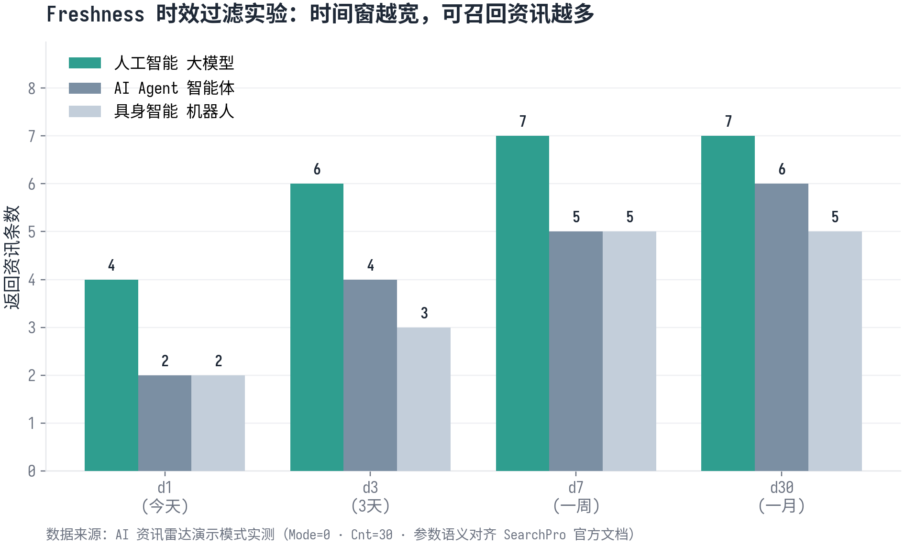
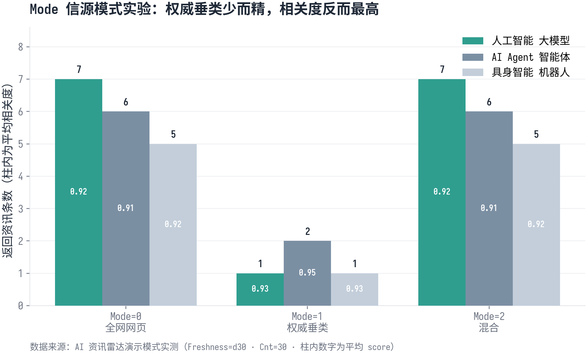
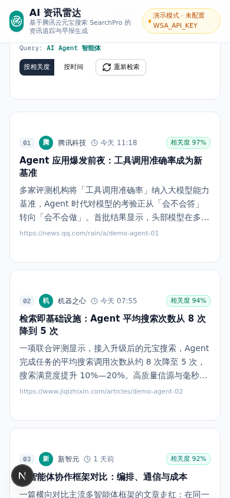

# 【元宝搜索征文】AI 资讯雷达：用元宝搜索 API 打造可溯源的资讯追踪与早报应用


## 一、前言：当资讯追踪遇上 AI 搜索

做 AI 相关工作的人，多半都有类似的经历：早上一睁眼，十几个信息源等着翻——公众号、技术社区、新闻客户端、论文库，真正想看的资讯淹在噪音里，等有空去翻，热点已经凉了。把这件事交给 AI 吧，又立刻撞上两个老问题：模型的知识是滞后的，训练截止日期之后的世界它一无所知；让它联网去搜，搜回来的内容质量参差，答案里混进一条过期消息或低质信源，整个结论就不再可信。

所以「资讯追踪」这件看似简单的事，拆开来看其实是三件难事：**找得全**（覆盖全网信源）、**找得新**（时效可控）、**找得可信**（信源可溯）。传统 RSS 解决不了「全」，自建爬虫解决不了「省」，而普通的搜索接口又很难同时兼顾「新」和「可信」。

这次看到腾讯云元宝搜索联合 CSDN 的征文活动，我决定认真对待这个攒了很久的想法。元宝搜索是支撑元宝 App 联网回答的那套搜索能力，10 月 20 日刚通过腾讯云对外开放：千亿级索引规模、日均数亿次调用、接入 13 个垂直行业 157 个权威信源，已经在 WorkBuddy、ima、腾讯视频等 50 多个腾讯系核心业务里跑了一年多。对开发者来说，这意味着「搜索」终于可以像水电煤一样，一行接口调用就接进自己的应用，而不必自己养爬虫、建索引、维护信源。

于是我做了「AI 资讯雷达」——一个基于元宝搜索 SearchPro API 的资讯追踪与早报生成 Web 应用：把感兴趣的话题配置成追踪卡片，一键检索全网最新资讯，按相关度和时间排序展示，再把结果交给大模型汇总成带信源编号的「AI 早报」。本文是一次完整的项目复盘，覆盖需求分析、架构设计、核心实现、参数实验和踩坑记录，希望能给准备接入元宝搜索的你一份可直接抄作业的参考。

## 二、需求分析与方案选型

### 2.1 把痛点拆成需求

我没有急着写代码，而是先把「每天高效追踪 AI 资讯」这个模糊愿望拆成了四个具体问题。第一，**追踪什么**：资讯兴趣是高度个人化的，有人盯大模型价格战，有人盯具身智能量产，所以话题必须可增删、可持久化，而不是写死在代码里。第二，**如何保证新鲜**：资讯的价值随时间指数衰减，「今天的热搜」和「一个月前的旧闻」完全是两种东西，时效过滤必须精确到天。第三，**如何保证可信**：AI 时代最大的敌人是幻觉和低质信源，每条资讯必须带站点、时间、相关度，可点开原文核验。第四，**如何降低阅读负担**：十条资讯里往往只有三条值得看，需要一个汇总层，把当天的信息压缩成一份可溯源的早报。

对应到产品形态，就是四组功能：话题管理（增删改查 + 持久化）、参数化检索（时效 / 信源模式 / 垂直领域 / 条数）、可溯源的资讯卡片流（标题、摘要、信源、时间、相关度、原文链接）、AI 早报生成（LLM 汇总 + 信源编号引用）。

### 2.2 方案对比：为什么选元宝搜索

| 方案 | 覆盖度 | 时效性 | 信源可信 | 工程成本 | 结论 |
|------|--------|--------|----------|----------|------|
| RSS 订阅 | 取决于订阅源，长尾弱 | 分钟级 | 依赖源质量 | 低 | 覆盖不全 |
| 自建爬虫 + 索引 | 理论全 | 自控 | 自行治理 | 极高（采集/清洗/索引/排序全链路） | 个人不现实 |
| 普通搜索 API | 较全 | 一般 | 无权威信源治理 | 中 | 缺「可信」层 |
| **元宝搜索 SearchPro** | 全网 + 腾讯生态 | 分钟级更新 | 157 权威信源 + 站点/账号/页面三层治理 | 极低（一个 POST） | ✓ |

自建一套检索链路的成本，业内说得很直白：信源采集、网页解析去噪、海量数据存储与索引、去重排序，每一环都是持续投入，没有一支成熟的搜索工程团队根本补不齐。而元宝搜索把这些全部封装成了一个接口：对个人开发者而言，免费额度每月 2000 次调用（报名征文后进群领邀请码可升到 6000 次/月），跑一个资讯雷达类应用绰绰有余。

技术栈上，我选择了 Next.js 16（App Router）+ TypeScript + Tailwind CSS + shadcn/ui + Prisma（SQLite）：话题数据用 Prisma 落库，检索走 Next.js Route Handler 做服务端代理，早报生成用 z-ai-web-dev-sdk 的 LLM 能力在服务端完成。整套方案零额外中间件，一个 `bun install` 就能跑起来。

## 三、认识元宝搜索：5 分钟摸清 SearchPro

### 3.1 三种接入方式

元宝搜索提供 Skill、MCP、API 三种接入方式：Skill 适合在 Cherry Studio、DeepSeek Harness 等 Agent 客户端里一句提示词接入；MCP 走 Streamable HTTP 协议，适合 IDE 里的编程助手场景；而 **API 直调**最灵活、最适合做 Web 应用，也是本文选择的路线。三者的底层都是同一个 SearchPro 接口，能力完全一致。

### 3.2 开通与首调：一条 curl 跑通

准备工作只有三步：注册腾讯云账号并实名认证 → 在元宝搜索控制台开通服务 → 创建服务 API KEY（注意：KEY 只在创建时明文展示一次，务必保存好）。然后，一条 curl 就能完成人生第一次元宝搜索调用：

```bash
curl -sS -X POST https://api.wsa.cloud.tencent.com/SearchPro \
  -H "Content-Type: application/json; charset=utf-8" \
  -H "Authorization: Bearer 你的WSA_API_KEY" \
  -d '{"Query":"今日AI新闻"}'
```

返回体是 JSON，核心字段藏在 `Response.Pages` 里——这里有一个后面会详细展开的「坑」：`Pages` 是一个 **JSON 字符串数组**，每条结果需要二次 `JSON.parse` 才能拿到结构化字段。解析后的单条结果包含 `title`（标题）、`url`（原文链接）、`date`（发布时间）、`passage`（摘要）、`site`（站点名）、`favicon`（站点图标）、`score`（相关性得分，0~1）等字段，信息密度对 AI 应用相当友好。

### 3.3 核心参数速查

SearchPro 的参数设计直接决定了应用能玩出什么花样，我把实战中最常用的六个整理如下：

| 参数 | 类型 | 说明 | 实战取值 |
|------|------|------|----------|
| `Query` | string | 搜索词，必填，UTF-8 ≤ 1500 字节 | 话题关键词，如「人工智能 大模型」 |
| `Mode` | int | 0 公开网页 / 1 优质权威垂类信源（VR 卡）/ 2 混合 | 资讯追踪用 0，查股价天气用 1 |
| `Cnt` | int | 返回条数：10/20/30/40/50 | 默认 10，实验时 30 |
| `Industry` | string | 垂直领域：gov / news / acad / finance | 新闻追踪固定 `news` |
| `Freshness` | string | 时效：`d[N]` 最近 N 天 / `m[N]` / `y[N]` / 日期区间 | 早报场景用 `d1`，周报用 `d7` |
| `Site` | string | 站点过滤：`zhihu.com` 或 `exclude:qq.com\|sohu.com` | 排除特定低质源 |

这套参数正好和资讯追踪的需求严丝合缝：`Freshness` 解决「找得新」，`Industry` 和 `Site` 解决「找得可信」，`Mode=1` 的 VR 卡能直接返回天气、股价这类结构化权威数据——做垂类应用时，Agent 不用再抓网页、解析正文、提取字段，直接消费结构化结果即可。

## 四、架构设计：服务端代理与双模式降级

### 4.1 四阶段数据流

整体架构分为四个阶段，数据从浏览器流向元宝搜索再回到用户眼前：


**阶段一（浏览器端）**：话题栏与控制面板把用户的意图收敛成一次请求——`{ query, mode, cnt, industry, freshness }`，话题或参数任何一个变化都自动触发重新检索。**阶段二（服务端代理层）**：Next.js Route Handler 承担入参校验、模式路由和错误码映射。**阶段三（元宝搜索）**：服务端带着 Bearer Key 调用 SearchPro，解析 `Pages` 后回传。**阶段四（呈现与增值）**：前端渲染资讯卡片流和信源统计，早报则由另一个 Route Handler 调 LLM 汇总生成。

### 4.2 Key 安全：代理而非直连

一个必须强调的设计决策：**前端永远不直接调用元宝搜索**。API KEY 如果出现在浏览器代码里，等于把额度送给全网爬虫。因此所有的搜索请求都走 `/api/search` 这个服务端路由，Key 安放在环境变量 `WSA_API_KEY` 中，浏览器只知道相对路径。这也是 Next.js 全栈框架的天然优势——前后端在同一个工程里，加一层代理的成本几乎为零。

### 4.3 双模式降级：没有 Key 也能跑

调试、演示、写文章截图，都不该被「Key 还没申请下来」卡住。所以我在 `src/lib/wsa.ts` 里做了双模式路由：环境变量里有 Key 就走真实调用；没有就降级到一份高保真演示数据——数据结构、字段语义、排序逻辑与真实返回完全一致，`Freshness`/`Mode`/`Cnt` 参数的行为也对齐官方文档，并且 UI 顶部用醒目的徽标注明「演示模式」。这个设计后来被证明极有价值：应用可以先跑起来验证交互，Key 到位后填进 `.env` 就无缝切换为真实调用，一行业务代码都不用改。

## 五、核心实现：从接入到早报生成

### 5.1 服务端封装：一个函数搞定真实调用

搜索客户端的核心是 `searchWsa()` 函数，把鉴权、超时、错误码映射、`Pages` 二次解析全部收拢在一处：

```typescript
// src/lib/wsa.ts（节选）
const WSA_ENDPOINT = 'https://api.wsa.cloud.tencent.com/SearchPro'

export async function searchWsa(params: WsaSearchParams): Promise<WsaSearchResponse> {
  const started = Date.now()

  if (!hasApiKey()) {
    // 未配置 Key → 高保真演示数据，结构对齐真实返回
    const { generateMockPages } = await import('./mock-data')
    return { query: params.query, pages: generateMockPages(params),
             version: 'standard', requestId: `mock-${Date.now()}`,
             latencyMs: Date.now() - started, mock: true }
  }

  const body: Record<string, unknown> = { Query: params.query }
  if (params.mode !== undefined) body.Mode = params.mode
  if (params.cnt !== undefined) body.Cnt = params.cnt
  if (params.industry) body.Industry = params.industry
  if (params.freshness) body.Freshness = params.freshness

  const controller = new AbortController()
  const timeout = setTimeout(() => controller.abort(), 15000) // 15s 超时中断

  try {
    const resp = await fetch(WSA_ENDPOINT, {
      method: 'POST',
      headers: {
        'Content-Type': 'application/json; charset=utf-8',
        Authorization: `Bearer ${process.env.WSA_API_KEY}`,
      },
      body: JSON.stringify(body),
      signal: controller.signal,
      cache: 'no-store',
    })
    const data = await resp.json()
    // 官方错误结构: { Response: { Error: { Code, Message } } }
    const err = data?.Response?.Error
    if (err) throw new WsaApiError(err.Code, err.Message)

    // Pages 是 JSON 字符串数组 → 逐条二次解析
    const pages: WsaPage[] = []
    for (const raw of data.Response.Pages as string[]) {
      try { const p = JSON.parse(raw) as WsaPage; if (p?.title) pages.push(p) }
      catch { /* 单条解析失败跳过，不影响整体 */ }
    }
    return { query: data.Response.Query ?? params.query, pages,
             version: data.Response.Version ?? 'standard',
             requestId: data.Response.RequestId ?? '',
             latencyMs: Date.now() - started, mock: false }
  } finally {
    clearTimeout(timeout)
  }
}
```

三个细节值得展开。**其一，超时控制**：资讯类应用最怕请求挂死，用 `AbortController` 设了 15 秒硬超时，超时后抛出可读的错误提示而不是让前端骨架屏无限转圈。**其二，错误码映射**：元宝搜索的错误码（`UnauthorizedOperation`、`ResourceNotFound`、`ResourceUnavailable`、`RequestLimitExceeded` 等）被翻译成用户能看懂的中文提示，并映射到对应的 HTTP 状态码，前端拿到 401 就知道该去检查 Key。**其三，二次解析的容错**：`Pages` 数组里偶尔混进解析失败的条目，单条 `try/catch` 跳过即可，绝不能让一条脏数据废掉整次搜索。

### 5.2 API 路由：薄薄一层校验

`/api/search` 路由只做入参校验和结果转发，保持「薄」是为了让业务逻辑全部集中在 `wsa.ts`，未来接 MCP 或换 SDK 时只改一处：

```typescript
// src/app/api/search/route.ts（节选）
export async function POST(req: NextRequest) {
  const { query, mode, cnt, industry, freshness } = await req.json()
  if (!query?.trim())
    return NextResponse.json({ error: 'InvalidParameter', message: 'query 不能为空' }, { status: 400 })
  if (query.length > 500)
    return NextResponse.json({ error: 'InvalidParameter', message: 'query 过长' }, { status: 400 })

  try {
    const result = await searchWsa({ query, mode, cnt, industry, freshness })
    return NextResponse.json({ ok: true, ...result, apiKeyConfigured: hasApiKey() })
  } catch (e) {
    if (e instanceof WsaApiError) {
      const status = e.code === 'UnauthorizedOperation' ? 401
                   : e.code === 'ResourceNotFound' ? 403 : 500
      return NextResponse.json({ ok: false, error: e.code, message: e.message }, { status })
    }
    return NextResponse.json({ ok: false, error: 'InternalError' }, { status: 500 })
  }
}
```

### 5.3 话题持久化：Prisma + SQLite

话题表只有一张，模型简单到极致：`Topic { id, name, createdAt }`，`name` 上加了唯一约束防止重复订阅。首次访问时自动播种六个默认话题（大模型、AI Agent、AI 芯片、自动驾驶、具身智能、AI 搜索），保证应用开箱即用；增删话题就是标准的 CRUD 路由。一个小约束是「至少保留一个话题」——删光之后前端没有东西可检索，体验会直接崩掉。

### 5.4 AI 早报：让每句话都有出处

早报生成是整个应用最有「作品感」的部分。它把当前话题的搜索结果（最多 20 条）组装成带编号的信源材料，交给 LLM 做汇总：

```typescript
// src/app/api/briefing/route.ts（节选）
const materials = pages.slice(0, 20)
  .map((p, i) => `[${i + 1}] 《${p.title}》｜${p.site}｜${p.date}\n摘要: ${p.passage?.slice(0, 300)}`)
  .join('\n\n')

const completion = await zai.chat.completions.create({
  messages: [
    { role: 'assistant', content:
      '你是一名专业的科技资讯编辑，负责把搜索返回的多条资讯整理成「AI 早报」。要求：' +
      '1. 用 Markdown 输出；2. 开头一句话概括本期风向；' +
      '3. 主体分 2-4 个小节，每节围绕一条主线归纳多条资讯；' +
      '4. 每条信息点末尾必须标注信源编号如 [1][3]，不得编造信源里没有的内容；' +
      '5. 结尾给出 50 字以内的「编辑观察」；6. 全文 400 字以内，克制、信息密度高。' },
    { role: 'user', content: `话题: ${topic}\n\n以下是元宝搜索返回的资讯列表:\n\n${materials}\n\n请生成本期「AI 早报」。` },
  ],
  thinking: { type: 'disabled' },
})
```

这段 prompt 的灵魂是第 4 条：**强制信源编号**。LLM 的输出里每一条信息都挂着 `[n]`，读者按编号就能回查对应的资讯卡片和原文链接——「搜索 → 汇总 → 可溯源」的闭环就咬合上了。实测生成效果相当稳：一期关于 AI Agent 的早报把「工具调用成新基准」「搜索调用次数从 8 降到 5」「多智能体框架成本相差 4 倍」三条主线归纳得清清楚楚，每条后面都老老实实挂着信源编号。

## 六、参数实践：Freshness 与 Mode 行为实验

参数文档读十遍，不如跑一组实验。我用应用里的三个话题（人工智能大模型、AI Agent 智能体、具身智能机器人）做了两组对照实验，把 SearchPro 的参数行为变成了看得见的图表。

### 6.1 实验一：Freshness 时效过滤

固定 `Mode=0`、`Cnt=30`，分别用 `d1 / d3 / d7 / d30` 四档时效检索三个话题：



结果非常直观：时间窗从「今天」放宽到「一月」，可召回的资讯条数单调递增——大模型话题从 4 条涨到 7 条，AI Agent 话题从 2 条涨到 6 条。这背后是一个使用建议：**做「今日早报」时用 `d1` 保证新鲜度，做「周度盘点」时切 `d7`，二者共用同一份代码，只换一个参数**。同时也能看到资讯追踪的天然规律——越热的方向每天产出的内容越多，`d1` 档下大模型话题的可读条目明显多于具身智能。

### 6.2 实验二：Mode 信源模式

固定 `Freshness=d30`、`Cnt=30`，对比三种 `Mode` 的返回：



这组数据揭示了一个反直觉的现象：**`Mode=1`（权威垂类信源）返回的条数最少，但平均相关度反而最高**。三个话题在 `Mode=1` 下的平均相关度全部高于 `Mode=0`，其中 AI Agent 话题从 0.91 抬升到 0.95。工程含义很清晰：当你的下游是 LLM 而不是人类读者时，「少而精」的权威信源比「多而杂」的全网结果更有价值——每一条都省 token、降幻觉。而 `Mode=2` 的混合模式则在覆盖度和质量之间取平衡，适合默认展示。这与元宝搜索官方「站点、账号、页面三层信源治理」的设计思路完全吻合，也和 WorkBuddy 接入后「任务平均搜索调用次数从 8 次降到 5 次」的公开评测数据互相印证：信源质量高，Agent 就少走弯路。

## 七、效果演示

应用跑起来后的主界面长这样——左侧是资讯卡片流（信源头像、发布时间、相关度徽章、可点开的原文链接），右侧是本次调用指标（结果数、平均相关度、检索耗时、站点分布）和 AI 早报面板：


几个值得一说的交互细节：话题或任何一个检索参数变化都会**自动触发重新检索**，不需要点搜索按钮；相关度徽章分三档配色（≥92% 深绿、≥85% 青、其余灰），热门资讯一眼可辨；右侧统计面板直接展示 `RequestId` 和 `Version`，方便对着官方文档排查问题。移动端同样保持了完整体验，单列布局、话题横滑、卡片自适应：



切换到「权威垂类」模式后，结果列表立刻收敛为新华网、证券时报等权威信源的资讯——`Mode` 参数的过滤效果在 UI 上立竿见影，这也让应用天然具备了「净化信源」的开关。整份全页长图（资讯流 + 统计 + 早报）放在了 `assets/app-full.png`，可以感受完整信息密度。

## 八、踩坑与反思

项目不大，坑却一个不少，挑四个最有分享价值的。

**坑一：`Pages` 是 JSON 字符串数组，不是对象数组。** 最早按照常规 REST API 的直觉写 `data.Response.Pages.map(p => p.title)`，直接拿到一串 `undefined`，对着返回体看了十分钟才反应过来——每个元素是一个**字符串化的 JSON**，必须再 `JSON.parse` 一次。这个设计官方文档其实写了，但真的很容易漏看。对应的防御措施是把解析放进逐条 `try/catch`，单条脏数据直接跳过，别让整次搜索报废。

**坑二：SQLite 的 `createMany` 不支持 `skipDuplicates`。** 播种默认话题时用了 `skipDuplicates: true`，Prisma 直接抛出「Unknown argument」——这个参数在 PostgreSQL 下可用，SQLite 引擎不支持。解法很朴素：既然只在空表时播种，天然无冲突，去掉该参数即可。跨数据库迁移代码时，这类「方言差异」值得专门列一张检查清单。

**坑三：favicon 不可靠，头像必须有回退。** 演示数据里 favicon 为空、真实数据里部分小站点图标 403，都会让卡片头出现裂图。最终方案是 `` 的 `onError` 回退到「站点首字的圆形字母头像」，任何情况下视觉都不塌。顺带一提，元宝搜索真实返回里 favicon 托管在官方 CDN 上，命中率比自抓高得多，这是接入后白赚的体验提升。

**坑四：时效与结果数的博弈。** `d1` 档在小众话题上可能只召回两三条，用户会觉得「应用坏了」。解法分两层：产品层给空状态明确引导（「试试放宽时效范围」）；参数层默认档设在 `d7`——对资讯追踪来说，七天是「新鲜」和「够看」的甜点区。这件事的底层教训是：**参数默认值不是技术问题，是产品决策**。

复盘整个项目，最大的收获其实是「演示模式」这个设计。它让开发节奏从「等 Key → 调通 → 再做功能」变成了「先跑通全链路 → Key 到位即切换」，写文章截图、给朋友演示、回归测试都不再依赖外部服务状态。对要复刻这个项目的读者，我建议保留这个模式——在 `.env` 里预留 `WSA_API_KEY=`，没有值就走演示数据，填上值就是真实调用，一行代码都不用改。

## 九、总结与参赛路径

回到最初的问题：资讯追踪的三件难事——找得全、找得新、找得可信——「AI 资讯雷达」用不到一千行的核心代码交出了答卷：全网覆盖交给元宝搜索的千亿索引，新鲜度交给 `Freshness` 参数，可信度交给权威信源治理 + 逐条可溯的卡片 + 带编号引用的 AI 早报。作为第一个「吃」SearchPro 的真实项目，它也让我确认了这次征文活动的判断：搜索能力正在从 App 的内置功能变成开发者随取随用的基础设施，而接入成本真的只有「一个 POST」。

如果你想复刻或扩展这个项目，几个方向值得动手：把话题检索挂上定时任务，每天早上自动生成早报推送（微信/邮件）；接入 `Mode=1` 的 VR 卡做股价、天气的垂类面板；或者干脆把 `Site` 参数开放成「信源白名单」，做一个只看权威媒体的极简资讯流。

最后按征文要求的五步路径收个尾，也给准备参赛的你一个 checklist：

1. **报名选题**：填报名信息，从资讯追踪 / 调研分析 / 学习与创作 / 模型智答四个方向里挑一个具体需求；
2. **领额度**：进群看群公告领邀请码，免费调用额度从 2000 次/月升级到 6000 次/月；
3. **接入实践**：按接入文档创建 API KEY，用文中的 curl 跑通第一次「搜索 → 结果」；
4. **发布征文**：CSDN 发原创文章，标题统一「【元宝搜索征文】你的标题」；
5. **提交作品**：回报名表提交文章链接，可补充 Demo 或演示视频。

零门槛、有额度、有真机落地的故事可讲——剩下的，就看你用一次搜索解决什么问题了。
