# AI 资讯雷达 2.0：把「搜情报 → 写文章 → 出成片」全流程交给 AI 工作流

这是一篇用运行效果说话的项目复盘。文中的每一张截图、每一个 GIF、每一份数据，都来自当前代码库的真实运行——不是设计稿，不是规划图。演示视频与全部产物随图包一并提供，可逐帧核验。

先给结论：**AI 资讯雷达 2.0 是一个 AI 原生的自媒体工作流平台**。它把自媒体创作者的一天压缩成四步——AI 搜索找线索、六步流水线出图文稿、三通道渲染出视频成片、一键排版适配微信。全程只有「确认」动作需要人：确认选题方向、确认发布。

从输入一个检索词，到拿到一篇带信源脚注的成稿、一张 AI 生成的封面、一支带口播与字幕的成片视频，中间的检索、取证、写作、审稿、配图、排版、分镜、渲染，全部由工作流自动完成。

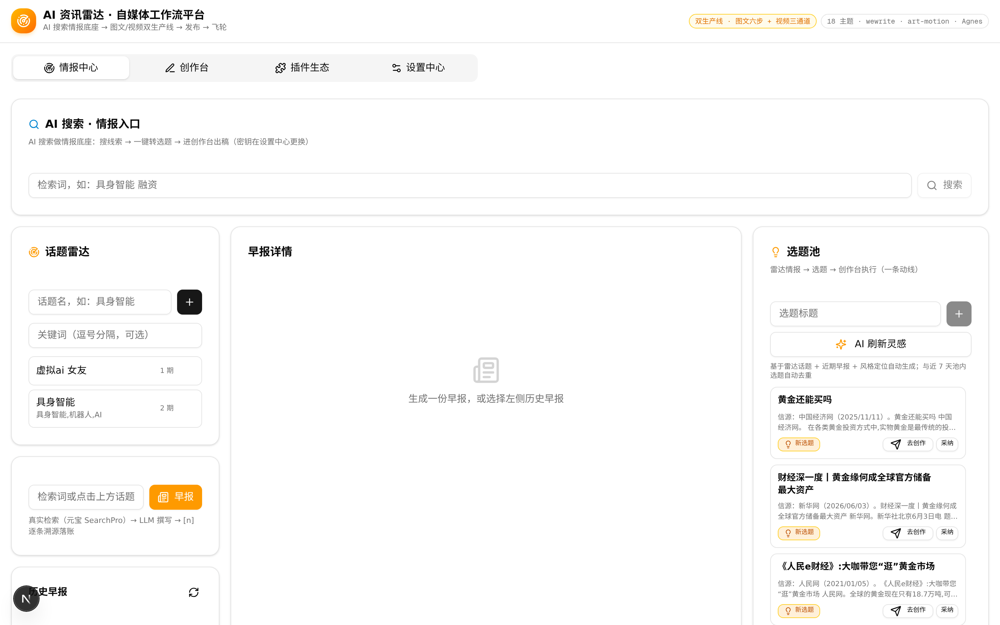

技术栈一句话说完：Next.js 16（App Router）+ TypeScript + Prisma（SQLite）+ Tailwind CSS 4，跑在 Z.ai 的开发环境里，文本生成、语音合成、AI 生图走 z-ai-web-dev-sdk，联网检索走元宝搜索 SearchPro。零额外中间件，`bun install` 即起。

---

## 一、问题：不是缺 AI 能力，是缺一条把能力串起来的流水线

过去一年，AI 的单项能力都不缺了：搜索有联网 API，写作有大模型，生图有扩散模型，配音有 TTS。但一个自媒体创作者的真实日常仍然是割裂的——开十几个标签页翻资讯，把链接贴给 ChatGPT 问摘要，把摘要粘进编辑器手写成稿，再开剪映排视频。每一次「粘贴」，上下文就丢失一次；每一个工具，都只解决一段。

「AI 资讯雷达 2.0」要解决的是拼接问题：**把这些单点能力组织成一条端到端的工作流，让资讯从「被发现」到「可发布」之间不再有人工搬运**。这条流水线必须同时满足三个工程约束——

1. **可信**：每条引用可溯源。检索结果必须带信源与时间，成稿脚注必须能点回原文，杜绝幻觉内容混进发布层。
2. **确定**：AI 输出天然波动，但产品行为必须稳定。上游任何一环故障（限流、拦截、超时），流水线要降级续跑而不是崩溃。
3. **可扩展**：模型供应商会换、会加。今天用元宝搜索 + Z.ai SDK，明天加一个 Agnes 免费池，应该是改配置而不是改代码。

围绕这三个约束，产品收敛为四个工作区：**情报中心、创作台、插件生态、设置中心**。下面逐一走查，全部配真实运行截图。

---

## 二、情报中心：AI 搜索做底座，检索即情报

工作流的入口是一个检索框，背后是元宝搜索 SearchPro API——千亿级索引、157 个权威信源、分钟级更新。输入检索词，返回的每条结果带标题、摘要、信源站点、发布时间、相关度与原文链接。

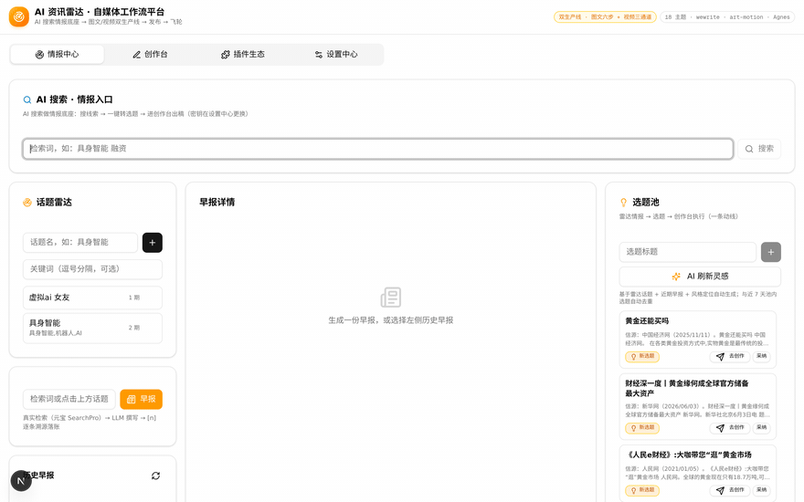

上面这个 GIF 是一次完整的真实检索：输入「AI Agent 多模态模型最新进展」，几秒内返回带信源标注的结果流。注意每张卡片下方的站点与日期——百度百科、腾讯科技、今日头条，都是可点开核验的原文。

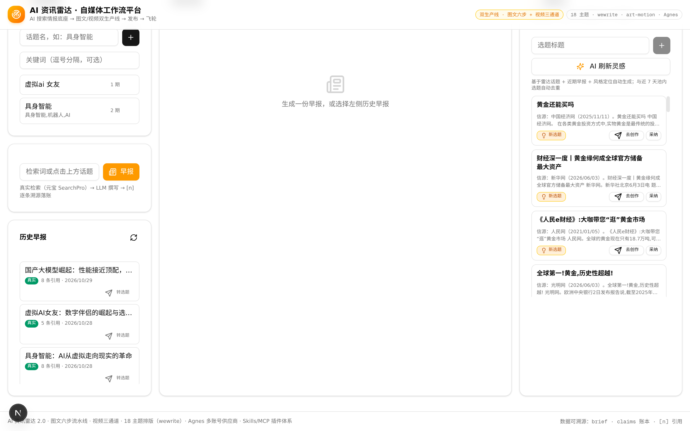

检索结果的每一行都有「转选题」按钮：一条资讯从「情报」变成「选题」，一次点击完成。选好的选题直接进入创作台的 run 队列，检索上下文随之带入——创作者不需要再复制粘贴一次。

这个入口同时承担话题追踪：配置感兴趣的话题卡片（如「具身智能 融资」「AI 编程助手」），定时刷新最新资讯，AI 汇总生成带信源编号的早报。早报的每一条都标注来源与日期，点击可回原文——汇总层不牺牲可核验性。资讯的「全、新、可信」三个要求，都由搜索 API 的能力兜底，产品层只做组织与呈现。

一个容易被忽略的细节：检索入口与创作台之间不是简单的「搜索+粘贴」关系。检索结果卡片上的「转选题」会携带检索上下文一起入队——后续取证步骤复用同一批线索，避免同一条资讯被反复检索。上下文在工作流内流转，而不是在人的剪贴板里流转，这是「零搬运」的具体含义。

---

## 三、创作台（上）：图文六步流水线，从选题到成稿

创作台的核心是一条六步流水线：**brief 任务书 → claims 联网取证 → 人格初稿 → 五维审稿 → 封面生成 → 微信排版**。每一步都有明确的输入输出与质检点，全部状态落库可回溯。

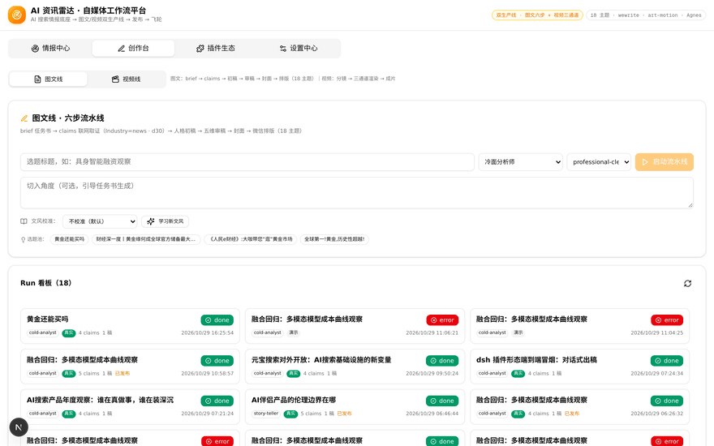

上面 GIF 是一次真实 run 的完整走查：从 run 看板点开「多模态模型成本曲线观察」，六步状态卡逐屏展开。注意状态卡上的标注——「真实检索」「2 条 fact 主张取证：2 条找到来源」，这些是流水线自己写的运行账目，不是静态文案。

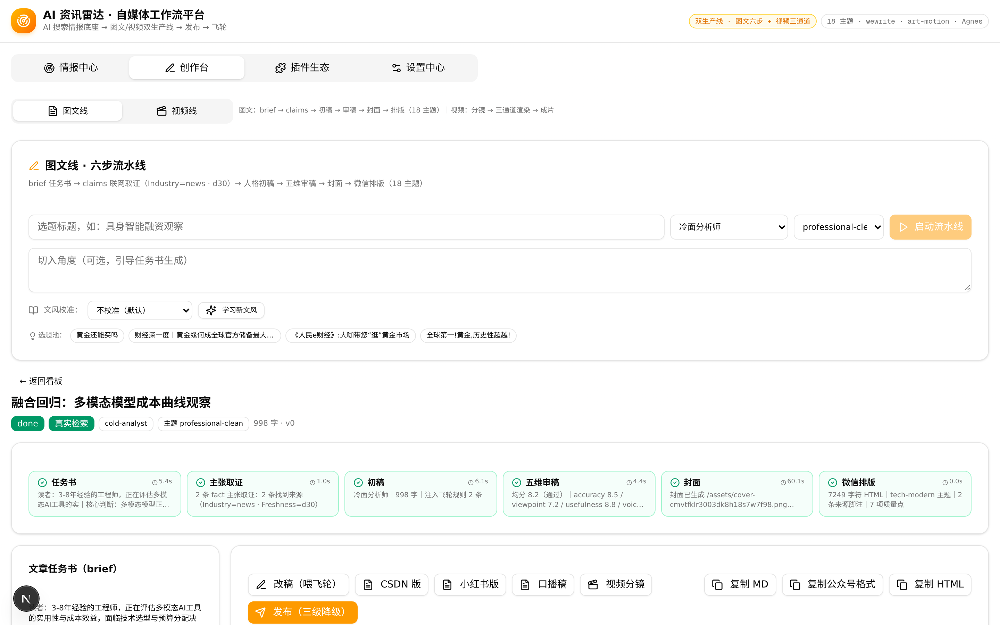

六步中值得展开的是前两步。**brief 任务书**不是一句提示词，而是一份结构化的写作约束：目标读者画像、核心判断、内容边界、风格定位（设置中心里填的账号定位与禁忌清单在这里注入）、七人格选择、飞轮规则（引导读者关注/评论的策略性结尾，可开关）。任务书生成后先落库再进入下一步——后续任何一步出问题，都能回溯到当时的任务书现场。

第二步「主张取证」：初稿动笔前，流水线先把选题拆成若干待核验的主张（claims），逐条调用搜索 API 找证据，只有找到信源支撑的主张才允许进入成稿，并携带 `[n]` 编号脚注。取证参数可调（信源领域 Industry、时效窗口 Freshness，如 news / d30），事实类主张强制带 URL，观点类主张标注为评论。这是对「AI 写新闻容易编」的直接防御——**不是靠提示词求模型别编，而是靠流程让编的内容进不了稿**。

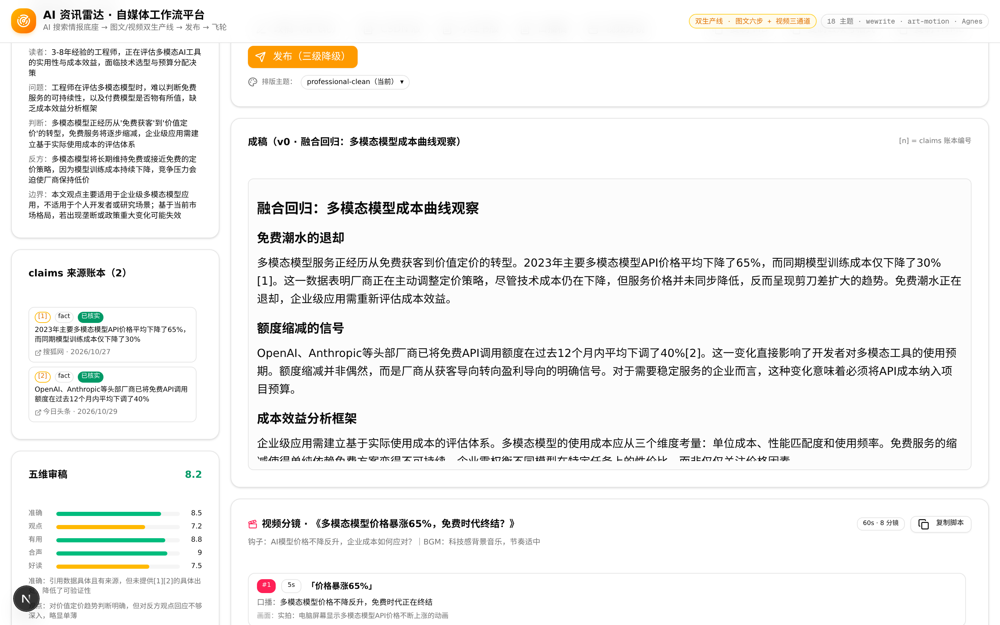

成稿环节的两个产物如上图：一篇冷面分析师人格撰写的 998 字成稿（含 5 条主张、2 条来源脚注），和一张 AI 生成的封面图（59KB 落盘）。初稿支持七种创作人格——冷面分析师、故事讲述者等，人格决定行文结构与语气，但证据链规则对所有人格一视同仁。

成稿之后的审稿是「五维」结构化质检：事实准确性、逻辑连贯、风格一致性、读者价值、合规风险，每个维度独立评分与评语，不过关的维度触发定向重写而不是全文重写。最后一步排版引擎支持 18 套微信主题（wewrite 体系：专业极简、科技暗黑、少文派风、毒舌快评等六大类），输出的是粘贴即用的公众号 HTML——带暗黑模式适配、粘贴不丢样式的 span 加固、来源脚注区。同一篇成稿可以在不同主题间一键重排，适应不同账号的调性。

---

## 四、创作台（下）：视频三通道，从分镜到成片

图文稿完成后，同屏切换到「视频线」，把成稿变成一支带口播、字幕与 BGM 的竖屏成片。

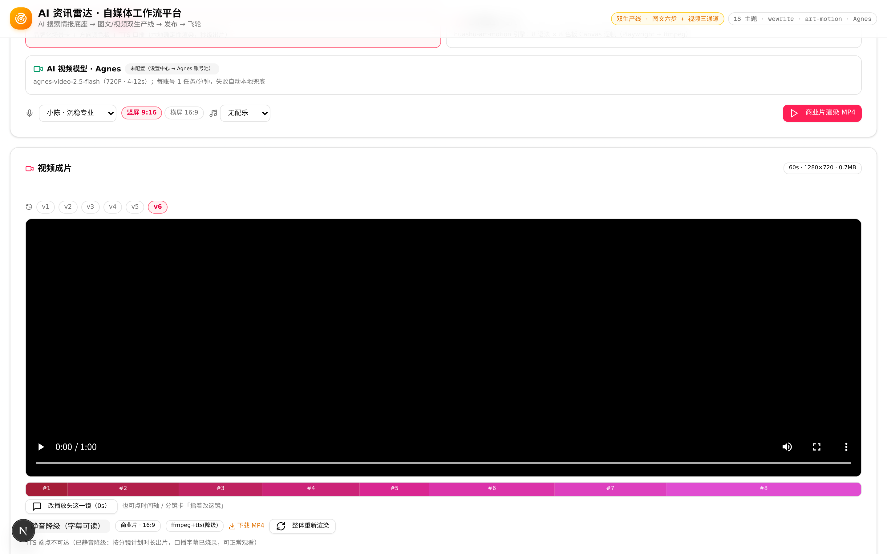

流程是「导演三方向 → 分镜 → 渲染」：先让 AI 提案三个导演方向（语言风格、节奏、调色板各不相同，并标出推荐项），选定后生成逐镜分镜脚本——每镜有字幕、口播词、画面描述与素材建议，总时长、钩子文案、发布文案一并产出。分镜不是一步到位的成品，而是可逐镜修改的草稿：每镜带秒数调节（4-12s）与「指着改」入口。分镜表下方是渲染通道选择区：

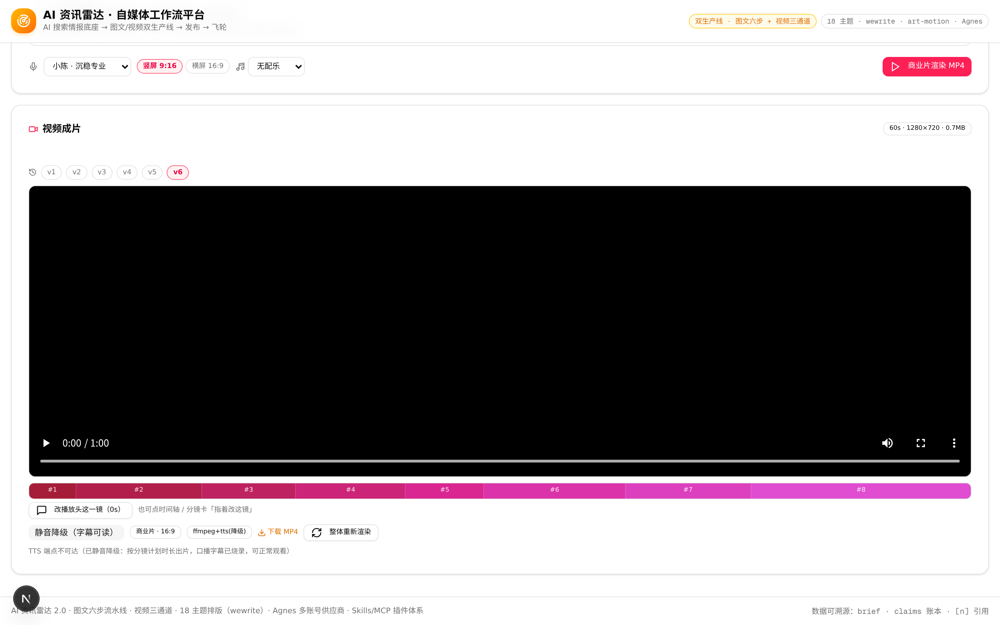

三条渲染通道各有明确分工——**本地双风格**（motion 商业片 / art 艺术动画，Playwright + ffmpeg 确定性渲染，秒级出片）、**Agnes AI 视频模型**（720P 真实生成，接入多账号池）、**自动回退**（优先 AI，失败无缝切本地）。本地通道的成片带 TTS 口播与字幕对齐、BGM 预设混音（可选多种风格预置，ffmpeg 合成时归一化响度）。成片播放器带版本树：v1 基线，之后每次「指着改」生成 v2、v3——点某一镜提修改意见，只重渲染该镜，其余镜头复用，版本之间可一键切换对比。

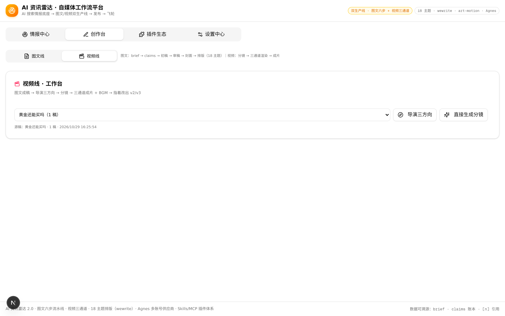

指着改是这条流水线最「自媒体」的功能：创作者对着成片说「第三镜的口播太书面了」，系统定位到该镜、改脚本、重渲染、出新版本，全程不动其他镜头。图包里附了一支真实成片 `demo-final-video.mp4`（720P，约 2MB），就是这条流水线的原始输出，可下载核验。

---

## 五、插件生态与设置中心：把「供应商」做成一等公民

这两个工作区是三个工程约束里「可扩展」的实现现场。

**插件生态**走开放协议：Skills 目录热加载（扫描 `skills/*/SKILL.md`，即装即用），MCP 走 Streamable HTTP 接外部工具服务器，连接状态与工具清单在插件中心可视化管理。ASR、TTS、LLM 这些 Z.ai 平台能力以技能卡片的形式注册，工作流按需调用——平台自身的 AI 能力和社区生态的 AI 能力，在调度层是同一种东西。

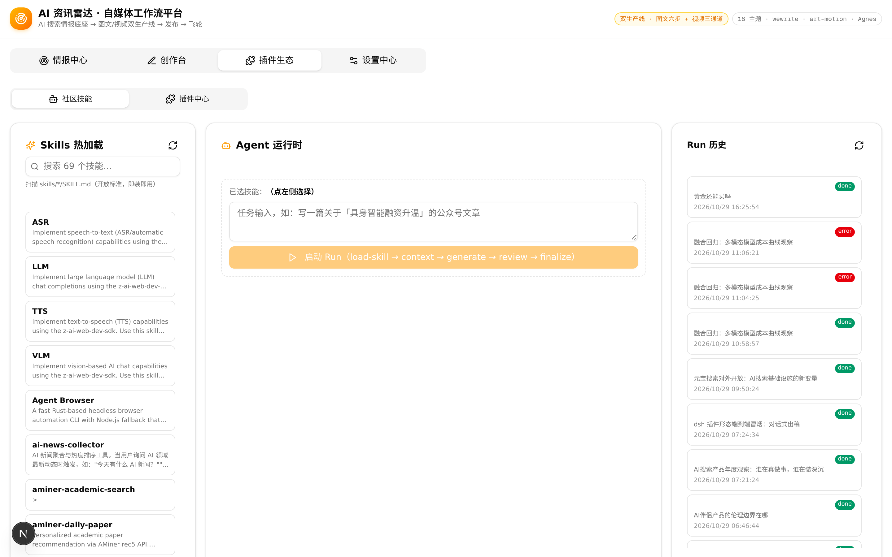

插件中心还实现了 **models.json 协议互通**：把当前所有供应商配置导出为一份标准 models.json，也可导入 pi-ai、dsh 生态的现成配置文件——别人的多模型配置粘进来即用，不用逐项手填。对多工具流内容的创作者来说，这是一条「零重复配置」的通道。

**设置中心**是供应商注册表的主控台。所有 AI 能力统一抽象为 Provider：文本（zai-llm / agnes-llm / pi-ai / 自定义兼容端点）、搜索（元宝 SearchPro）、生图（zai-image / agnes-image）、视频（本地引擎 / agnes-video）。每个 Provider 声明能力接口（chat / search / generateImage / submitVideo + health 健康检查），注册表统一管理状态机——调用计数、失败率、最近错误、熔断状态全部落库可视。工作流只面对接口，不面对具体厂商；切换或新增供应商是改配置，不是改代码。

文本引擎四种模式可切（内置引擎 / Agnes 免费池 / pi-ai 统一引擎 / 自定义兼容端点），搜索、生图、视频各有独立配置卡，每张卡带「真实连通测试」按钮——测试不是 ping，是真发一次最小请求：搜索真查一条、生图真出一张（测完即删）、LLM 真回一句话。

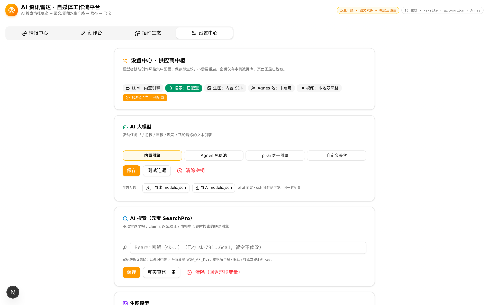

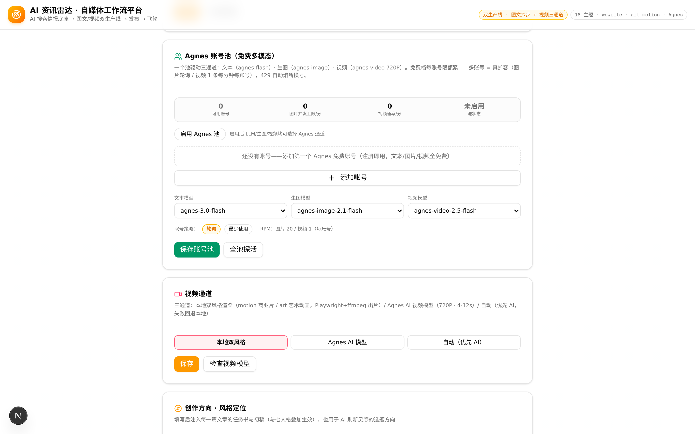

Agnes 多账号池是免费额度时代的扩容方案：每账号限额紧（图 20 RPM / 视频 1 任务每分钟），多账号池化是唯一路径。池子实现了轮询与 least-loaded 两种取号策略、滑动窗口限流、连续 429 熔断 30 秒、失败自动换号——这些状态机在设置页实时可见。探活用 `GET /models` 零成本完成，账号有效性与池开关状态分开展示，启用前就能验密钥。

---

## 六、工程韧性：真实世界的脏故障，与为它们写的代码

这部分没有截图，但值得用文字记录——因为它是「AI 应用能不能上线」与「AI 应用能不能留在生产环境」的区别。

开发过程中真实遇到并修复了四类故障：

1. **WAF 拦截页**：沙箱出口偶发被云端 WAF 拦截，上游 API 返回 405 + HTML 报错页。最初的前端直接 `res.json()` 解析，抛出 `Unexpected token '<'`。修复分两层：调用方对 HTML 响应做退避重试（实测重试后穿透成功），消费方对非 JSON 响应给出可读错误。
2. **限流风暴**：连续跑全量回归会打满网关配额，429 曾经让整条流水线直接 `status=error`。现在所有上游调用（搜索、LLM、生图）都带瞬态错误识别与指数退避重试。
3. **密钥随容器重置丢失**：只存 `.env` 的密钥在环境重建后消失，产品「无声降级」回演示模式。修复是把密钥沉淀进数据库，设置页明示密钥来源（库 / 环境变量）。
4. **`.gitignore` 静默吞源码**：一条裸 `test` 忽略规则把 `src/app/api/settings/test/` 路由挡在版本库外——文件在磁盘上存在、验证通过，但从未真正提交，容器重置即丢失。收窄为根路径规则后入库。

这四件事的共同教训是：**AI 应用的故障面比传统应用宽**——上游是异构的第三方服务，故障形态包括限流、拦截、超时、配额、非预期响应格式。容错不能是补丁，必须是每个 Provider 的标配结构。现在每个上游调用点都有同一套骨架：瞬态识别 → 退避重试 → 降级留痕 → 诚实上报。

---

## 七、真实运行验证：这一节全是硬数据

以一次端到端 run 为例（可复现）：

| 环节 | 真实产物 |
|------|----------|
| 检索 | REAL 模式，10 条真实信源（央广网 / 新华网 / 经济日报等） |
| 取证 | 4 条主张，2 条事实类带原文 URL 引证 |
| 成稿 | 1376 字 Markdown + 6860 字符微信排版 HTML |
| 封面 | AI 生图 101KB JPEG（1344×768）真实落盘 |
| 视频 | 三通道成片 MP4（720P，约 2MB） |
| 早报 | REAL 模式，8 条引用 |

除了端到端，项目维护一套 36 项的全量回归脚本（`bun scripts/full-regression.mjs`）：覆盖 18 主题注册、账号池语义（保存 / 脱敏回显 / 空密钥诚实失败）、pi-ai 模式切换、六步流水线终态、视频分镜、发布三级降级。**每一次提交前跑一遍，任何一项失败不交付**。发布环节本身是三级降级设计：首选真实发布通道，不可用时降级导出成品包（成稿 + 封面 + 视频齐备），最后一级是本地存档留痕——创作者的产出在任何故障组合下都不会丢。

风格系统贯穿全程：设置中心填写的账号定位、目标读者、语气文风、禁忌清单，会注入每一篇文章的 brief 任务书与初稿约束；「毒舌快评风」这类短平快变体也有独立模板。同一套情报底座，可以支撑严肃深度文与轻快吐槽文两种产品形态。

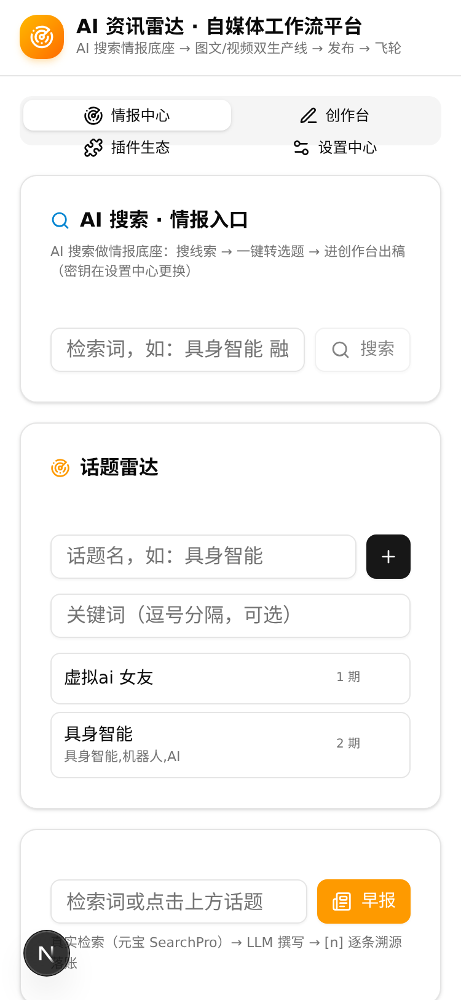

移动端 375px 视口全量适配，四工作区无横向溢出——自媒体创作者的手机审稿场景被当作一等公民对待。

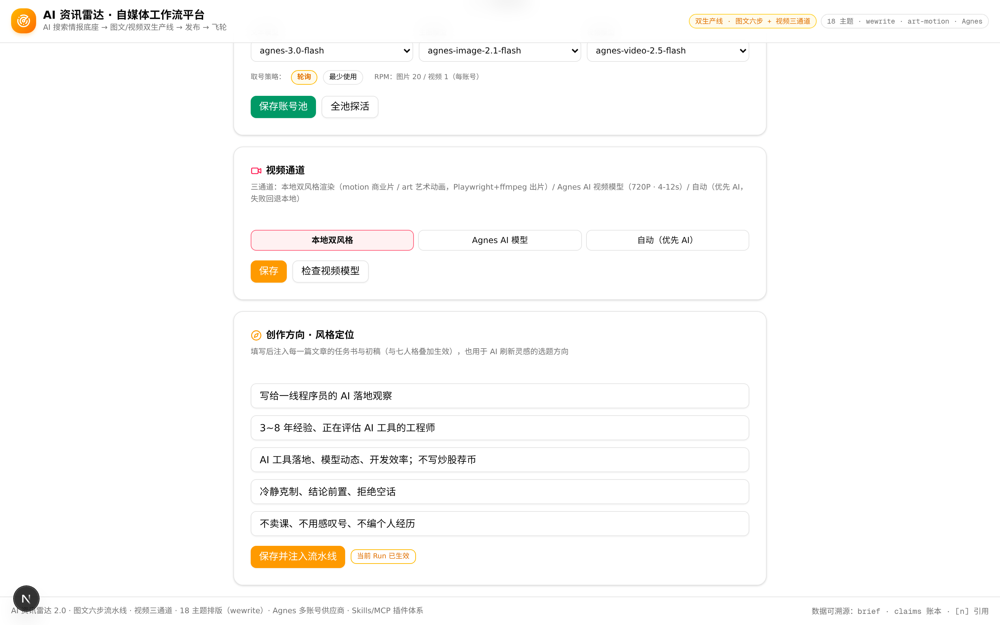

视频通道与风格定位同处设置中心：通道选本地、Agnes 还是自动回退是全局默认，具体到每个 run 还可临时切换；风格定位五项配置则决定了每一篇文章的基因。

---

## 八、结语

AI 资讯雷达 2.0 做的事可以概括为一句话：**把 AI 的单点能力，组织成一条可信、确定、可扩展的内容生产流水线**。

它不发明新的模型，而是认真对待模型之间的缝隙——检索结果的溯源、主张的取证前置、供应商的可插拔、故障的降级路径、成片与成稿的版本管理。这些工程决策不起眼，但它们决定了「AI 帮我干活」是一句口号还是一个日常可用的工具。

下一步的方向已经明确：Agnes 账号池接入更多免费通道、MCP 生态接入外部知识库、发布层对接更多平台。工作流的骨架已经立住，剩下的都是加积木。

所有截图与 GIF 均截取自当前运行实例，成片视频随图包提供，欢迎逐帧核验。
