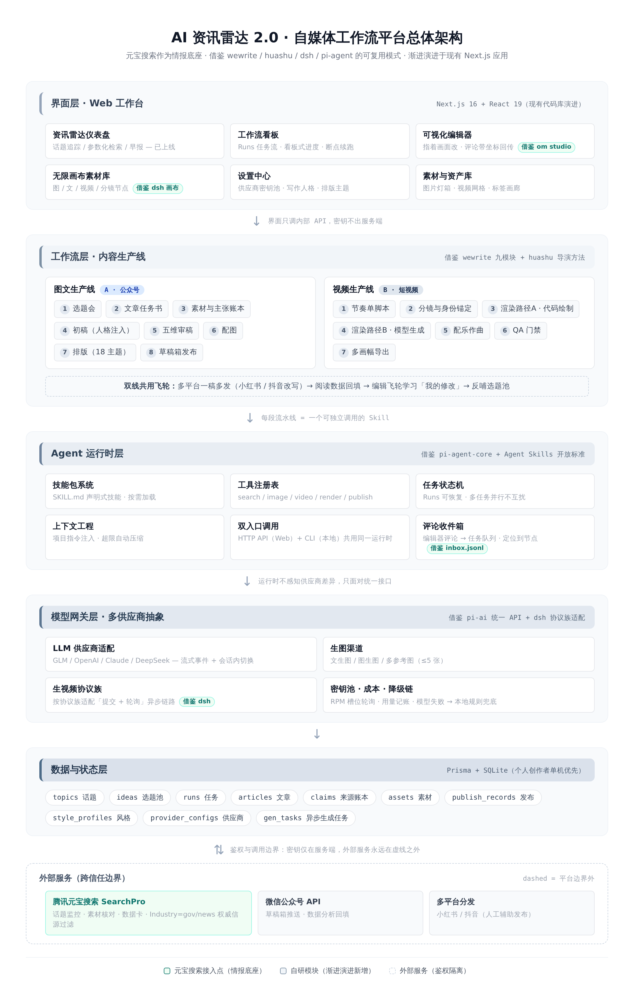

# 基于 AI 搜索打造自媒体工作流平台：AI 资讯雷达 2.0 演进方案

> **定位**：个人创作者的一站式「AI 编辑部」——元宝搜索做情报底座，图文 + 视频双生产线，越用越像你。
> **策略**：在现有 AI 资讯雷达（Next.js 16）代码库上渐进演进，不推倒重来。
> **方法**：深度研究 wewrite / huashu-motion / huashu-art-motion / dsh 双插件 / pi-agent 五个标杆，**借鉴其可复用的工程模式，打造我们自己的 Agent 体系**（非直接依赖集成）。
> **状态**：方案阶段；文中全部参考项目已在本地完成安装与验证（见第八章）。

---

## 一、背景与定位：从「资讯雷达」到「AI 编辑部」

AI 资讯雷达 1.0 已经跑通了「元宝搜索 → 话题监控 → 参数化检索 → 可溯源资讯流 → AI 早报」这条情报链路。但站在一个内容创作者的视角，它只回答了「今天发生了什么」，没有回答接下来的三个问题：**写什么（选题）、怎么写（生产）、写得怎么样（反馈）**。这三件事恰恰是自媒体人每天最耗时的环节——据统计类创作者普遍反映，一篇公众号文章从找选题到排版发布平均要 3~5 小时，其中真正「写」的时间往往不到三分之一，其余都耗在找素材、核对事实、配图、排版、一稿多发这些机械环节上。

本方案的核心判断是：**搜索是入口，工作流才是护城河**。元宝搜索解决了信息获取的时效性与权威性问题（Industry 参数过滤营销号、Freshness 锁定时间窗、157 个权威信源），这恰好是 AI 生成内容最容易被诟病的「幻觉」与「知识滞后」的解药。把这条可信的情报链路向前延伸，接上写作、审稿、配图、排版、发布、分发的完整流水线，再配上「学习我的修改」的风格飞轮，就是一个可持续运转的个人内容工厂。

目标用户锁定为**个人创作者自用**：单机单账号、优先跑通闭环、不考虑多租户与商业化。这个定位决定了三个架构取舍——数据层用 SQLite 而非分布式数据库；密钥管理用服务端环境变量而非 KMS；发布环节对需要企业认证的 API（如微信草稿箱）做能力降级而非硬依赖。后续若要演进为团队工具或 SaaS，这三个点是天然的扩展缝。

---

## 二、标杆研究：五个项目分别教会我们什么

### 2.1 wewrite——把公众号流水线拆成「判断 / 确定性 / 状态」三层

wewrite（v4.2.1，MIT 协议）是目前公众号工作流 skill 体系里完成度最高的开源实现：1 个主入口 + 9 个模块（topic / write / review / visual / publish / rewrite / learn / stats / style），覆盖「抓热点 → 选题评分 → 文章任务书 → 初稿 → 编辑审稿 → 配图 → 18 主题排版 → 草稿箱推送 → 一稿多发 → 数据回填」全链路。它的架构哲学一句话就能讲完：**Prompt 负责判断，Python 负责确定性，状态全部放在仓库外**（`~/.wewrite/runs/<任务编号>/`），因此 skill 目录复制到哪都能用，多篇任务并行不互扰，换机器只需带走状态目录。

最值得搬进我们平台的是四个机制。第一，**文章任务书（brief）先于写作**：写之前先明确目标读者、真正问题、核心判断、反方观点与适用边界，避免「AI 自己扩写跑偏」。第二，**主张与证据分离（claims 账本）**：事实、推断、意见、作者经历分别记录并逐项关联来源，无法支持的具体主张不进入初稿——这与我们雷达早报的「[n] 信源编号可溯源」天然同构，元宝搜索可以直接当 claims 的取证引擎。第三，**编辑飞轮的谨慎升级策略**：单次人工修改只作参考，重复出现或明确确认后才升级为稳定规则，防止一次口味误判污染长期风格。第四，**任务产物全留痕**：`brief.yaml / claims.yaml / draft.md / article.md / review-report.json` 每步落盘，随时可回答「为什么这样写」。

### 2.2 huashu-motion——视频即代码，修改即评论

huashu-motion（732 star，MIT）把「商业级产品宣传片」的生成拆成了一条可审计的工程链路。它的第一性选择是：**一支片子就是一个 `index.html`**——画面全部用 GSAP / Canvas / Three.js / SVG 代码绘制，不调用任何视频生成模型，每一帧只由代码和时间决定。这带来三个决定性优势：零 API 成本（实测 22 秒动效片用 DeepSeek V4.1 Flash 仅花 1.95 元，缓存命中 99.4%）、完全可回归（改一行代码只影响那一处画面）、格式开放（片子就是网页，带走就能用）。

它的「导演规则」不是拍脑袋的模板，而是量出来的：对 Apple、Nothing、GoPro、Vercel、Linear 等 21 支真实发布片逐支测量切点、节拍、响度与能量曲线，再拆解 142 支高互动片子归纳出 20 种运动语言，最终沉淀为「节奏单」规则——3 秒内要有钩子、中段要有一次爆发、最响的那一下前面先停一拍。交互侧的杀手锏是 **om studio 编辑器 + 收件箱协议**：在浏览器里按 C 键点一下画面，写下要改什么，评论自动带上时间点、场景、被点中的元素和它在源码里的位置，写进 `inbox.jsonl`；Agent 侧 `om inbox --wait` 接单，先把你点的那一帧和那一小块截图放大看一眼，再只改那一处，改完回一句人话。「标题、数字、颜色、停留时长」这类参数则直接变成编辑器右侧的输入框，根本不用等 Agent。这套「指着画面改」的协作协议，是我们要搬进 Web 平台的核心资产。

### 2.3 huashu-art-motion——风格是可以积累的资产

huashu-art-motion 是 huashu-motion 的艺术表达引擎：36 种实做艺术风格（从岩洞壁画到 Rick & Morty，共 53 张风格配方卡）、9 种解说语法（Kurzgesagt 扁平穿行 / Vox 剪报红线 / 3Blue1Brown 对象变形 / 财经图表「先轴后数据只标一件事」等）、8 种可参数化的片段类型（JSON 规格驱动，横竖屏与透明底精确到帧）。它证明了三件事：风格可以被形式化为配方卡而非玄学；解说语法可以按内容类型（科普 / 财经 / 故事）选型；配乐可以用纯代码合成（BPM 网格 + 动机换乐器 + 结尾音效序列）而不依赖任何收费接口。对图文线同样有直接启发——「财经图表先轴后数据」的语法可以移植为公众号数据卡片的排版规则。

### 2.4 dsh 双插件——多供应商生成的工程化答案

dsh-imagegen-video（63 star，Apache-2.0）是 DeepSeek Harness 生态里图片 + 视频一体化的画布插件，它的价值在于把「多供应商接模型」这件事做到了协议级严谨。**无限画布**上跑着图片、文本、视频、生成配置、分镜五类节点；**分镜节点**一个节点就是一列镜头，每镜一条提示词一个时长，还能「接上一镜尾帧」保证连续性；**身份锚定**把角色 / 物品 / 风格钉在节点上，之后每次生成都自动携带参考图，解决 AI 生成最头疼的跨镜头一致性。最值得抄的是**协议族适配**：不同视频供应商的提交 / 轮询协议差异极大（Agnes 走 `POST /v1/videos` + 轮询取 `metadata.url`；火山 Seedance 是方舟任务协议、参考图要带 `role: first_frame / last_frame / reference_image`；comemoe 只接受 16:9 / 9:16 / 1:1；Grok 的端点是 `/videos/generations`），它把差异全部封装在适配层，面板只暴露该模型真实支持的模式，未识别协议族会明确报错而不是静默发错请求。另外两处设计极为老练：**导演规划降级链**（提交前先用对话模型拆镜头，失败 / 超时 / 返回非法 JSON 时自动切本地规则规划，并在历史里标注降级来源，绝不静默把原句发出去）与**代码生成路径**（让对话模型写 JavaScript 绘图程序，在 `node:vm` 沙箱里逐帧渲染后交给 ffmpeg 编码，全程零网络请求零额度消耗，模型「答非所问」时降级为内置标题卡照样出片）。

dsh-agnes-multimodal 则示范了更轻的形态：一个包同时提供账号配置页 + `generate_image` + `generate_video` 两个模型工具，生成结果直接进对话流。三处细节值得记录：**账号池即 RPM 槽位**（N 个账号 = 视频 N 次 / 分钟、图片并发 10×N，官方明说同账号多 Key 不叠加限额）；**零成本密钥测试**（配置页的「测试」按钮只发一个 `GET /models` 就能校验密钥有效性）；**附件 offload 机制**（图片存进附件库后在模型上下文里替换为占位文本，界面照常渲染图片——上下文永远保持纯文本，这对控制长会话成本至关重要）。

### 2.5 pi-agent——极简运行时的骨架参考

Pi Coding Agent（earendil-works，MIT，我们已装 1.4.0）的信条是「There are many agent harnesses but this one is yours」：核心刻意保持极简，一切高级能力都通过扩展、技能、模板外挂。对我们最有参考价值的是它的**分层拆包**：`pi-ai`（统一多供应商 LLM API，20+ 提供商、流式事件、成本追踪、会话内换模型时上下文无损交接）+ `pi-agent-core`（工具调用与状态管理的运行循环）+ `pi-coding-agent`（CLI 交互壳）+ TUI / 遥测各司其职。以及**四种运行模式**：interactive（TUI）、print/JSON（脚本）、RPC（进程集成）、**SDK（嵌入自己的应用）**——我们的 Next.js API 路由本质上就是它的「SDK 模式」：Web 界面与本地 CLI 共用同一个 Agent 运行时。它的技能系统遵循 Agent Skills 开放标准（SKILL.md 声明、按需加载、渐进式披露不破坏 prompt cache），这与 wewrite / huashu 的 skill 是同一标准——**装一次 skill，Claude Code、Codex、OpenClaw、Hermes、pi 都能用**，这正是我们平台技能层的选型依据。

### 2.6 借鉴要点汇总

| 标杆 | 搬什么 | 落到我们平台的哪个子系统 |
|---|---|---|
| wewrite | 三层解耦、brief/claims 留痕、编辑飞轮、runs 可恢复 | 图文流水线 + Agent 运行时（任务状态机） |
| huashu-motion | 视频即代码、导演规则量化解法、inbox 评论协议、QA 门禁 | 视频生产线 A 路径 + 可视化编辑器 |
| huashu-art-motion | 风格配方卡、9 种解说语法、纯代码配乐 | 视频风格库 + 图文数据卡排版规则 |
| dsh-imagegen-video | 协议族适配器、导演规划降级链、身份锚定、node:vm 代码渲染 | 模型网关（生视频协议族）+ 视频生产线 B 路径 |
| dsh-agnes-multimodal | 账号池即限流槽位、GET /models 零成本探活、附件 offload | 模型网关（密钥池）+ 素材库 |
| pi-agent | pi-ai 统一抽象、四模式（SDK/RPC）、Agent Skills 标准、极简核心 | 模型网关 + Agent 运行时整体骨架 |

---

## 三、总体架构：五层解耦 + 一个外部情报底座



架构延续资讯雷达的蓝灰视觉与技术栈，自上而下五层，外加一个虚线边界的外部服务区。分层的原则来自 pi：**上层永远不感知下层供应商差异，层与层之间只通过显式接口对话**。

**界面层（Next.js 16 + React 19）**：资讯雷达仪表盘原样保留（话题追踪 / 参数化检索 / 早报），新增四个页面——工作流看板（Runs 任务的看板视图，对应 wewrite 的 runs 目录概念）、可视化编辑器（om studio 式「指着画面改」，见 4.5）、无限画布素材库（dsh 式节点画布，图 / 文 / 视频 / 分镜节点）、设置中心（供应商密钥池 / 写作人格 / 排版主题）。界面只调内部 API，密钥永远不出服务端——这是 1.0 已经验证过的安全边界。

**工作流层**：两条生产线 + 一条共用飞轮。图文线八步（选题会 → 任务书 → claims → 初稿 → 审稿 → 配图 → 排版 → 草稿箱），视频线七步（节奏单 → 分镜锚定 → 双路渲染 → 配乐 → QA → 导出），每一段都是可独立调用的 skill——「只要选题」「只要封面」这类单环节诉求在 wewrite 里被验证为高频真实需求，必须保留模块化触发。

**Agent 运行时层**：技能包系统（SKILL.md 声明式、按需加载）、工具注册表（search / image / video / render / publish 五类内置工具）、任务状态机（Runs 可恢复、并行不互扰）、上下文工程（项目指令注入 + 超限自动压缩）、评论收件箱（编辑器评论转任务队列）。**双入口设计借鉴 pi 的四模式**：HTTP API 服务 Web 界面，同一运行时未来可挂 CLI 壳服务本地终端，两侧共享技能与状态。

**模型网关层**：LLM / 生图 / 生视频 / 搜索四类 Provider 统一抽象（详见 4.1），附密钥池（账号 = RPM 槽位轮询）、成本记账与降级链（模型失败 → 本地规则兜底，降级必标注来源）。

**数据与状态层**：Prisma + SQLite，从 1.0 的单表 Topic 扩展为十张表（详见 4.6）。所有任务产物像 wewrite 一样逐步落盘，任何一步都可以回答「为什么这样生成」。

**外部服务区（虚线边界）**：元宝搜索 SearchPro 是情报底座（四层集成见第五章）；微信公众号 API 提供草稿箱与数据回填；小红书 / 抖音暂走人工辅助发布（无公开 API，改写产物复制粘贴 + 平台兼容校验）。

### 渐进演进映射：现有代码如何长出新层

| 现有资产 | 位置 | 演进动作 |
|---|---|---|
| 元宝搜索客户端（双模式降级） | `src/lib/wsa.ts` | 原样保留，注册为网关的第一个 SearchProvider |
| 早报生成（LLM + 强制信源引用） | `src/app/api/briefing` | 升级为运行时层的第一个「skill 化」接口，作为 skill-loader 的样板 |
| 话题 CRUD + 播种 | `src/app/api/topics` | 扩展出 ideas 选题池（评分字段） |
| 前端卡片流 / 统计面板 | `src/components/radar/*` | 保留；新增 studio / board / assets 三组组件 |
| Prisma schema | `prisma/schema.prisma` | 新增九张表（4.6） |

一句话：**不新建仓库，不加新框架，1.0 的每一行代码都在 2.0 里有明确位置**。这既是最低成本的演进，也让「元宝搜索征文」的资产持续增值。

---

## 四、核心子系统设计

### 4.1 模型网关：像 pi-ai 一样统一，像 dsh 一样能降级

网关的接口设计直接借鉴 pi-ai 的「统一模型集合」与 dsh 的「协议族」经验，把四类能力收敛为四个接口：

```ts
// src/lib/gateway/types.ts —— 平台唯一模型抽象
export interface LLMProvider {
  id: string                                   // 'glm-4.6' | 'deepseek-v4' | ...
  stream(ctx: ChatContext): AsyncIterable<StreamEvent>   // 流式事件：文本/工具调用/用量
  estimateCost(u: TokenUsage): CostRecord      // 成本记账
}

export interface ImageProvider {
  generate(req: ImageRequest): Promise<AssetRef>          // 文生图 / 图生图 / 多参考图(≤5)
}

export interface VideoProvider {
  submit(req: VideoRequest): Promise<{ taskId: string }>  // 提交（协议族差异封装在这两个方法里）
  poll(taskId: string): Promise<VideoTaskStatus>          // 轮询：Agnes / Seedance / comemoe / Grok 各自实现
}

export interface SearchProvider {              // 元宝搜索即第一个实现（wsa.ts 直接挂载）
  search(p: SearchParams): Promise<SearchResult>
}
```

三条工程铁律从标杆项目直接继承。**其一，未识别协议族明确报错**：dsh 的教训是「未识别的协议族会明确报错，不会静默发出形状错误的请求」，网关的 VideoProvider 注册表必须维持同样纪律，面板只暴露该模型真实支持的模式。**其二，降级链必须可观测**：视频导演规划失败 → 本地规则规划，且在任务历史里标注降级来源（`对话模型` / `本地规则`），绝不让用户以为走的是模型。**其三，密钥健康检查零成本**：每个 ProviderConfig 保存后先发一次 `GET /models` 级别的探活（dsh-agnes 的「测试」按钮模式），失败即标红，避免把坏 Key 带进生产链路。账号池按「N 账号 = N 个 RPM 槽位」轮询，个人创作者两三个免费档账号就能撑起日均产出。

### 4.2 Agent 运行时：技能包 + Runs + 双入口

运行时是平台的「编辑部中枢」，由五个模块组成。**skill-loader** 扫描 `skills/` 目录下符合 Agent Skills 标准的 SKILL.md（name / description / references），按需加载、渐进披露——这意味着 wewrite 十件套、huashu 双件装好即被识别，平台内置的 `radar-topic`、`radar-write` 等自研 skill 也走同一协议，**平台技能与社区技能零差别共处**。**tool-registry** 注册五类内置工具（search / generate_image / generate_video / render / publish），LLM 通过工具调用驱动流水线——1.0 的早报接口其实就是「LLM + 上下文注入」的最简形态，把它 skill 化就是运行时的第一个用例。**run-manager** 实现 wewrite 式任务状态机：每个 Run 是一个目录 / 一条 DB 记录，`status` 走 `pending → running → blocked(等人工确认) → done / failed` 状态流转，产物逐步落盘，断点续跑、多任务并行互不干扰。**context-engine** 负责项目指令（AGENTS.md 等价物）注入与超限压缩。**inbox** 消费编辑器评论队列（见 4.5）。

双入口借鉴 pi：Web 侧走 Next.js API 路由（等价 pi 的 SDK 模式），本地侧预留 CLI 壳（等价 interactive 模式）——两侧共享技能包、工具注册表与 Runs 数据，技能生态一次建设、两端受益。

### 4.3 图文流水线：每一步都有产物文件


图文线完整复刻 wewrite 的质量机制并接上元宝搜索。选题会：雷达话题监控（Freshness=d1/d7）+ AI 早报聚类作为热点输入，叠加同题密度观察与历史去重，产出十个候选并按「热度 × 差异度 × 人格匹配」评分。任务书：目标读者、真正问题、核心判断、反方、边界五要素先定义再动笔。素材与主张账本：**这是元宝搜索的主战场**——每条 claim 用 SearchPro 核对，`Industry=news` 限定新闻信源、`Site=exclude:` 排除低质站、`Freshness=d7` 锁定时效，来源 URL、站点、日期、score 全部落库，早报的 [n] 引用机制直接复用。初稿：7 套写作人格（midnight-friend / cold-analyst / tech-coder 等）注入风格，禁止编造作者经历。审稿：准确 / 观点 / 有用 / 合声 / 好读五维判断，不过关就地改稿复审，通过才生成成稿与编辑报告。配图与排版：生图渠道出封面与内文图（预估费用先算），排版引擎输出微信兼容 HTML（18 主题起步、暗黑模式、外链转脚注、CJK-Latin 自动加空格——这四类微信兼容修复 wewrite 已趟平，直接继承清单）。发布：草稿箱推送仅在用户明确授权且配置齐全时执行，否则保留本地 HTML + 「粘贴加固」（section 包裹，复制进编辑器不掉样式）。

### 4.4 视频流水线：A/B 双渲染路径

视频线的脚本层共用图文线的选题与 claims（数据卡直接引用账本数字），生产层提供两条并行路径让用户按成本与风格取舍。**A 路径·代码绘制（huashu 模式）**：节奏单先行（3 秒钩子 / 中段爆发 / 最响前停一拍），一支片子就是一个 `index.html`（GSAP / Canvas / SVG），浏览器渲染引擎并行多开 Chrome 逐帧截取后 ffmpeg 合成，配乐用 ABC 记谱纯代码合成——零 API 成本、改一行只影响一处、产物即网页。**B 路径·模型生成（dsh 模式）**：导演规划先把一句话需求拆成镜头 / 动作 / 运镜 / 时长 / 风格（规划可预览且不消耗渲染额度，降级自动切本地规则），再经协议族适配器提交 + 轮询，分镜节点支持「接上一镜尾帧」，身份锚定钉住角色与物品跨镜一致，时间线做入出点 / 转场 / 静音后本机 ffmpeg 拼接。两条路径在 QA 门禁汇合：翻页感检测、空画面检测、单帧闪烁检测、对比度抽帧检查，全过才进多画幅导出（横竖屏 / GIF / 透明底 / 网页分享页）。个人创作者的推荐策略是 **A 为主 B 为辅**：日更数据卡、热点快评走 A 路径零成本；品牌向宣传片、需要实拍质感时才启 B 路径。

### 4.5 可视化编辑器：把「指着画面改」搬进 Next.js

编辑器是本方案交互上的最大增量，协议直接移植 huashu 的 inbox 设计并 Web 化：

```json
// 编辑器评论 → POST /api/inbox（一条评论 = 一个可执行修改任务）
{
  "ts": 3.2,                                   // 时间点（视频）或滚动位置（图文）
  "runId": "r-20261028-03", "sceneId": "s02",
  "elementId": "headline-1",                   // 被点中的元素
  "rect": { "x": 120, "y": 48, "w": 320, "h": 56 },
  "codeAnchor": "runs/r-20261028-03/film/index.html#L142",
  "comment": "这个数字换成 73 万，停留 2 拍"
}
```

处理循环照抄 om 的三步纪律：Agent 接单后**先把你点的那一帧 / 那一屏和被点元素放大截图看一眼**，再**只改那一处**，改完回一句人话并停在原位刷新预览；每一版都保留，随时撤回。「标题 / 数字 / 颜色 / 停留时长」这类高频参数则渲染成编辑器右侧的表单输入框直接改，不进 Agent 队列——把 LLM 调用留给真正需要判断力的修改。图文线同样吃这套协议：排版预览页点选段落即可发起「改写这一段」的定向任务。

### 4.6 数据模型扩展

```prisma
// prisma/schema.prisma —— 在 Topic 基础上新增九张表（节选核心字段）
model IdeaCandidate { id String @id @default(cuid())  topicId String?  title String
  score Float  dimensions Json   status String @default("pool")   createdAt DateTime }
model Run   { id String @id @default(cuid())  kind String   // article | video
  status String @default("pending")  steps Json  artifacts Json  createdAt DateTime }
model Claim { id String @id @default(cuid())  runId String
  claimType String   // fact | inference | opinion | experience
  text String  sourceJson Json   // 元宝搜索返回的 url/site/date/score 原样留痕
  verified Boolean? }
model Asset { id String @id @default(cuid())  kind String   // image | video | html
  provider String?  costCents Int @default(0)  path String  meta Json }
model PublishRecord { id String @id @default(cuid())  runId String  platform String
  externalUrl String?  metrics Json?  publishedAt DateTime? }
model StyleProfile { id String @id @default(cuid())  persona String  rules Json
  exemplars Json?  updatedAt DateTime }
model ProviderConfig { id String @id  kind String  // llm | image | video | search
  endpoint String?  healthy Boolean @default(true)  rpmSlots Int @default(1) }
model GenTask { id String @id  providerRef String  protocolFamily String?
  status String @default("submitted")  pollCount Int @default(0)  resultAssetId String? }
```

设计原则延续 wewrite 的「留痕可追溯」：claims 表就是来源账本的数据库形态，GenTask 表把异步视频任务的轮询过程显式化（协议族字段直接来自 dsh 的概念），StyleProfile 的 rules 字段只存「重复出现或明确确认」的稳定规则——飞轮的谨慎升级策略落在 schema 层。

---

## 五、元宝搜索的四层深度集成

元宝搜索不是平台的一个功能，而是贯穿四层的情报底座：

| 集成层 | 场景 | SearchPro 参数要点 | 平台产出 |
|---|---|---|---|
| **情报层** | 话题监控 / 早报聚类 | `Freshness=d1~d7`、`Mode=2` 混合信源 | 选题池输入 + 日更内容日历 |
| **写作层** | claims 事实核对 | `Industry=news/gov`、`Site=exclude:低质站`、`Freshness=d7` | 来源账本（可溯源引用 [n]） |
| **视频层** | 数据卡取数 | `Mode=1`（垂类 VR 卡：天气 / 股价 / 金价） | 节奏单里的实时数字卡 |
| **复盘层** | 热点回访 | `Freshness=d30` 对比选题时的 `d1` 快照 | 选题复盘报告（追热点是否追对） |

其中写作层的用法是差异化关键：**Industry=gov 强制党政机关信源、Industry=news 限定新闻机构**，从源头挡住营销号污染大模型；复盘层则是被多数工具忽略的一环——选题时留 d1 快照、发布后拉 d30 回访，能定量回答「这个热点我们追晚了还是追早了」，反哺选题评分权重。

---

## 六、演进路线图

| 阶段 | 周期 | 交付物 | 验收标准 |
|---|---|---|---|
| **Phase 0（已完成）** | — | 资讯雷达 1.0：话题 / 检索 / 早报，双模式降级 | ESLint 零错误；端到端验证通过 |
| **Phase 1 · 图文闭环 MVP** | 2~3 周 | 模型网关 v1（LLM + Search 两类 Provider）、选题池、write / review 两个 skill、本地排版预览（3 主题起步） | 一句话从话题到微信兼容 HTML 成稿，claims 全程可溯源 |
| **Phase 2 · 发布与飞轮 v1** | 2~3 周 | 生图渠道 Provider、微信草稿箱（授权后）、rewrite 一稿多发、learn 编辑飞轮 | 端到端发布一篇真实文章；「学习我的修改」规则落库 |
| **Phase 3 · 视频线 A** | 4~6 周 | 代码绘制引擎、节奏单 skill、studio 编辑器 + inbox 协议、QA 门禁 v1 | 30 秒数据卡视频全流程零 API 成本产出，指着画面改闭环 |
| **Phase 4 · 视频线 B** | 4~6 周 | 协议族适配器（≥2 家）、导演规划（含降级）、分镜 / 身份锚定 / 时间线 | 一支带身份一致角色的 15 秒模型生成短片 |
| **Phase 5 · 飞轮与沉淀** | 持续 | stats 数据回填、learn-theme 排版学习、自研 skill 打包 | 选题评分权重被真实阅读数据修正过至少一轮 |

排期原则与 1.0 一致：每个 Phase 结束都有「可发布到 CSDN / 公众号的真产物」，同时尊重元宝搜索额度（2000 次/月，邀请码 6000 次/月）——按日均 30 次检索估算，6000 档位绰绰有余，网关侧再做按 Provider 的月度配额记账防超支。

---

## 七、风险与对策

**微信 API 权限门槛**：草稿箱与数据分析接口需认证服务号，个人订阅号不可用。对策：发布环节三级降级——草稿箱 API（有权限时）→ 本地 HTML + 粘贴加固（默认路径）→ 长图导出；数据回填无 API 时用手动导入阅读截图 + OCR 的兜底方案。**成本失控**：B 路径视频生成与生图按次计费。对策：A 路径零成本优先、生成前强制费用预估、GenTask 记账、ProviderConfig 月度配额熔断。**内容合规**：AI 生成内容的平台标注要求趋严。对策：成稿自动附 AIGC 声明脚注（wewrite 已内置）、Industry 权威信源过滤、11 项机械检查（套话 / 碎句 / 重复节奏）。**模型风格漂移**：不同模型产出品味差异真实存在（huashu 作者实测结论）。对策：人格规则锁风格 + 便宜模型跑量、贵模型审稿的双模型路由（wewrite 的成本路由思路）。**搜索额度与网络**：元宝搜索免费档 2000 次/月且偶发超时。对策：演示模式降级已验证、检索结果按 query+参数缓存复用、429 时指数退避。

---

## 八、本地安装与验证实录（本环境已完成）

以下操作在当前开发环境真实执行并验证通过，同构适用于任何 Linux / macOS 机器：

```bash
# ① wewrite 十件套（CLI 4.2.1 + 10 个 skill，MIT）
git clone --depth 1 https://github.com/imraywang/wewrite.git ~/wewrite
cd ~/wewrite && bash install.sh        # uv 装 CLI + 符号链接到 ~/.claude/skills 与 ~/.agents/skills
wewrite --version                      # → 4.2.1 ✅
wewrite themes                         # → 18 个主题全部列出 ✅

# ② huashu-motion（skill + om CLI 源码，MIT）与 huashu-art-motion（MIT）
npx skills add alchaincyf/huashu-motion        # 官方一行装法
npx skills add alchaincyf/huashu-art-motion    # 仓库本身即单个 skill
# 网络受限时的等价兜底（本环境实测可用）：
curl -sL -o hm.tar.gz https://codeload.github.com/alchaincyf/huashu-motion/tar.gz/refs/heads/main
tar xzf hm.tar.gz && ln -sfn "$PWD/huashu-motion-main/skills/huashu-motion" ~/.claude/skills/huashu-motion

# ③ pi-agent（多供应商 Agent 运行时，MIT）
npm install -g --ignore-scripts @earendil-works/pi-coding-agent
pi --version                           # → 1.4.0 ✅（支持 20+ 提供商、四模式运行）
```

本环境踩坑记录三条，均有解法：GitHub 直连偶发 GnuTLS 中断 → 改走 codeload tarball；`uv` 走清华镜像下载 wheel 被 403 → 直连官方 PyPI 源成功；`npx skills add` 超时 → tarball + 手动符号链接等价完成。最终 `~/.claude/skills/` 与 `~/.agents/skills/` 各就位 **12 个 skill**（wewrite 十件套 + huashu 双件），且全部符合 Agent Skills 开放标准——Claude Code、Codex、OpenClaw、Hermes、pi 皆可直接识别。dsh 双插件按既定策略**只研究不安装**（其宿主是 DeepSeek Harness，协议模式已折进第四章设计）。

---

## 九、下一步行动

1. ~~**补齐真实 Key**~~ ✅ **已完成（2026-10-28）**：`sk-` 服务 API KEY 已配置并验证，SearchPro 真实检索链路全通（延迟约 220~520ms），雷达切换为真实数据模式。
2. ~~**启动 Phase 1**~~ ✅ **已开工（2026-10-28）**：模型网关 v1 + 选题池 + Skills/MCP 扩展骨架已落地并端到端验证，详见第十章与附录 A；write / review 两个 skill 化工作流为下一个里程碑。
3. **技能侧并行**：wewrite 十件套已就位，可直接在 coding agent 里用「今天写什么」「检查一下」练手，积累 prompt 判断层的实测语料，反哺自研 skill 的规则设计。
4. **发布节奏**：资讯雷达征文（CSDN）与本方案可作为系列内容连发，平台每个 Phase 产出一篇复盘文，本身就是「用平台做平台的内容营销」闭环。

---

## 十、扩展体系：插件、Skills 与 MCP（学 dsh，Phase 1 已落地）

> 本章回答一个关键追问：**能不能学 dsh，让平台支持插件、skills、MCP 等扩展能力？** 答案是能——而且 Phase 1 当天就把这三层的骨架全部跑通并完成了端到端验证。扩展能力不再是路线图上的承诺，而是本机正在运行的代码。

### 10.1 dsh 最值得学的不是某个适配器，而是「新增能力不改核心」

深读 dsh 双插件后可以得出一个判断：它真正的精髓不在 Agnes 协议或 Seedance 适配器本身，而在一条架构纪律——**新增一个视频供应商 = 新增一个适配器文件 + 注册，核心调度代码零改动**。未识别的协议族会明确报错而不是静默走错；`GET /models` 零成本探活让账号池的健康状态一目了然。把这条纪律推广到自媒体平台的全部能力面，就得到三种互补的扩展粒度：

| 扩展粒度 | 解决什么 | 声明载体 | 更新频率 | dsh 对应物 |
|---------|---------|---------|---------|-----------|
| **Provider 插件** | 模型能力（LLM/检索/图像/视频） | TS 模块实现四类接口 | 低频、代码级 | 协议族适配器 + 账号池 |
| **Agent Skill** | 工作流知识（怎么写/怎么审/怎么剪） | SKILL.md 声明式文件 | 中频、纯文本 | 导演规则库 + 风格配方卡 |
| **MCP 工具** | 外部能力（文件/浏览器/数据库…） | config/mcp.json 一段配置 | 高频、零代码 | 无（这是 dsh 没有的层，补上它） |

三者恰好覆盖「能力—知识—工具」三个变化速度不同的维度：模型供应商一年换不了几次，写作方法论一个月一迭代，而想接一个新工具可能只是今天的突发奇想。分层之后，每一层的更迭都不惊动其它两层。

### 10.2 Provider 插件层：模型网关即协议族注册表

Phase 1 落地的网关代码把第四章的接口设计变成了现实实现，共五个模块：

```ts
// src/lib/gateway/ 的实际文件与职责
types.ts        // 四类 Provider 接口（llm/search/image/video）+ 探活报告类型
registry.ts     // 运行时注册表：register / unregister / list / healthAll 并发探活
bootstrap.ts    // 装配器：幂等注册全部内建 Provider
providers/wsa-search.ts   // 第一个 SearchProvider：包一层 1.0 的 wsa.ts（代码零废弃）
providers/zai-llm.ts      // 第一个 LLMProvider：收口 z-ai-web-dev-sdk
```

两个设计决策值得展开。其一，**`isConfigured()` 做成方法而非静态属性**：Key 是否配置是运行时状态，快照式的 `configured: true` 会撒谎，探活按钮按下去的每一秒都应该是真话。其二，**healthAll() 用 Promise.allSettled 并发探测**：单个 Provider 挂掉只污染自己的报告，绝不拖垮整个面板——这正是 dsh「账号池一个槽位故障不影响其它槽位」的容错思路。

实测结果：`wsa-search` 探活 220ms 返回真实 requestId，`zai-llm` 探活 407ms 对话链路正常；Image / Video 的「提交 + 轮询」协议族接口已预留（对应 Agnes、Seedance 的任务模型），Phase 3 接入首批生成供应商时无需再动 registry 一行代码。

### 10.3 Agent Skills 层：把 81 个 SKILL.md 变成平台的工作流模板库

Skills 加载器（`src/lib/skills/loader.ts`）实现了 Agent Skills 开放标准的最小闭环：扫描用户级（`~/.claude/skills/`）与项目级（`<project>/skills/`）双目录，解析每个 SKILL.md 的 YAML frontmatter（name / description / allowed-tools），通过 `/api/skills` 输出结构化清单。

实测收获了一个意外之喜：本环境的项目级技能池里有 69 个系统技能（ASR / VLM / agent-browser / aminer 学术检索等），加上用户级 12 个（wewrite 十件套 + huashu 双件），**平台开箱即拥有 81 个可发现的工作流能力**——这说明「SKILL.md 即插件」不是理论，而是本机已经存在的生态事实。手写的 frontmatter 解析器刻意不引入 gray-matter 依赖，只覆盖顶层标量、`|` 块标量、`- item` 列表三种形态，把解析失败隔离在单个技能内（坏一个不坏一片）。

### 10.4 MCP 工具层：一段 JSON 配置 = 一个新工具宇宙

MCP 客户端（`src/lib/mcp/client.ts`）用约 200 行原生 `child_process` 实现了完整的 JSON-RPC 2.0 over stdio 协议：`initialize` 握手 → `notifications/initialized` → `tools/list` 枚举 → `tools/call` 调用，带自增请求 ID、超时 reject、进程退出时批量拒绝 pending、stderr 尾部留存用于报错定位。

配套的 `scripts/echo-mcp-server.mjs` 是一个 30 行的参考样板服务器（提供 `echo` 与 `time-now` 两个工具），它同时回答了「如何写一个最小 MCP 服务器」。端到端实测：`/api/mcp` 枚举出 echo 服务器的 2 个工具；`tools/call` 调用回显 `[echo@2026-10-28T06:02:40Z] 平台 MCP 调用链路 OK`。

这一层补上了 dsh 没有的能力：dsh 的工具是编译进插件的，而 MCP 让**任何**符合协议的外部服务器（文件系统、浏览器自动化、数据库、第三方 SaaS）的工具零代码接入——`config/mcp.json` 加一段配置即可。对个人创作者而言，这意味着社区发布过的每一个 MCP 服务器都是平台的潜在弹药库。

### 10.5 三层协同：一次「写公众号文章」如何穿过扩展体系

分层设计的价值要在协同时才真正兑现。设想 Phase 2 的一次完整创作：

1. **Skill 层**触发：用户说「就上个选题写正文」，wewrite-write 的 SKILL.md 被识别，其内含的 brief 任务书模板、claims 留痕规则注入本次运行；
2. **Provider 层**出力：网关路由——取证走 `wsa-search`（Freshness=d7 + Industry= gov），行文走 `zai-llm`，未来配图走 Image Provider；
3. **MCP 层**补位：需要读本地素材库时调 MCP 文件服务器的 `read_file`，需要抓取参考页时调浏览器服务器的 `navigate + snapshot`；
4. 全程产物落 Prisma（Run / Claim / Asset 表），编辑飞轮把本次人工修正沉淀回 Skill 的规则文件。

三层各司其职：Skill 决定「怎么做」，Provider 决定「谁来做」，MCP 决定「用什么做」。任何一层的升级——换模型、改文风、接新工具——都被隔离在自己的边界内。

### 10.6 插件包契约（Phase 4 预研）：三件套 = 一个可分发插件

当三层扩展各自成熟，自然的终局是统一的插件包格式。一个可分发的「雷达插件包」= 一个目录三件套：

```text
my-plugin/
├── plugin.json          # 清单：名称/版本/入口/权限声明（学 dsh 插件 manifest）
├── skills/*.md          # 携带的 SKILL.md 工作流知识（Agent Skills 标准）
├── providers/*.ts       # 可选：实现的 Provider 接口（如接入新视频供应商）
└── mcp.config.json      # 可选：捆绑的 MCP 服务器配置
```

装载时的安全边界借鉴 dsh 的 node:vm 沙箱思想：Provider 插件先在受限环境跑 healthCheck 探活，MCP 服务器默认无网络无文件权限、按 plugin.json 的权限声明逐项放行；未通过契约校验的包在注册表层面明确拒绝并给出原因——延续「绝不静默降级」的纪律。

---

## 附录 A：Phase 1 落地实录（2026-10-28）

**本次交付代码（10 个新文件 + 3 处改造）：**

| 模块 | 文件 | 说明 |
|------|------|------|
| 模型网关 | `src/lib/gateway/{types,registry,bootstrap}.ts` | 四类 Provider 接口 + 运行时注册表 + 装配器 |
| 内建 Provider | `src/lib/gateway/providers/{wsa-search,zai-llm}.ts` | 检索/LLM 两个真实实现 |
| Skills | `src/lib/skills/loader.ts` | 双目录扫描 + frontmatter 解析 |
| MCP | `src/lib/mcp/{client,config}.ts` + `scripts/echo-mcp-server.mjs` + `config/mcp.json` | JSON-RPC/stdio 客户端 + 样板服务器 + 配置 |
| 选题池 | Prisma `IdeaCandidate` 表 + `/api/ideas` 两个路由 | CRUD + 状态流转 + 去重 |
| API | `/api/gateway` `/api/skills` `/api/mcp` | 三层扩展体系的只读探查端点 |
| UI | `workbench/{ideas-panel,extensions-panel}.tsx` + 主页三 Tab 改造 + 资讯卡「加选题」 | 工作台三视图 |

**端到端验证清单（全部通过）：**

- ✅ SearchPro 真实检索：`mock: false`，10 条结果，延迟 515ms（Key 为控制台签发的 `sk-` 服务 KEY）
- ✅ 网关清单与并发探活：2 Provider 全部 `已配置`，wsa-search 220ms 健康 / zai-llm 407ms 健康
- ✅ Skills 扫描：81 个技能（用户级 12 + 项目级 69），frontmatter 解析正常
- ✅ MCP 枚举与调用：echo 服务器 2 工具在线；`tools/call` 回显成功
- ✅ 选题池 CRUD：创建 → 流转 shortlist → 按状态查询 → 重复入池被拦截 → 删除
- ✅ Agent Browser UI 验证：三 Tab 切换、真实模式徽章、「加选题」入池闭环、扩展体系三面板渲染、探活交互实时刷新
- ✅ ESLint `src` 目录零错误；dev.log 无运行时错误

**已知边界（诚实记录）：**

- Image / Video Provider 仅有接口占位，尚无实现（按路线图属 Phase 3）；
- MCP 客户端为 stdio 传输，SSE / Streamable HTTP 传输待后续按需补齐；
- Skills 目前为只读发现，启用/禁用状态与运行时注入属 Phase 2 的 Agent 运行时工作；
- 选题池的 `score` 字段暂由资讯相关度映射，Agent 智能打分待 LLM 选题管线接入。
